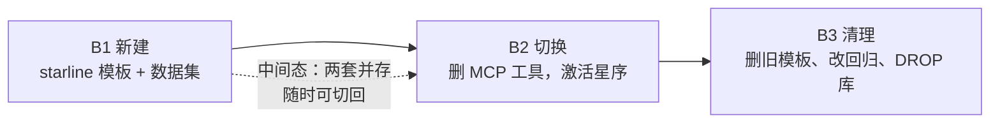

# 方案 B：彻底清理电商资产 + 星序演出业务落位

> 前提：已选定「方案 B —— 连数据集和回归套件一起清理」。
>
> 核查日期：2026-10-25。以下所有路径、行号、依赖关系均经源码实地核实。**本次未修改任何项目文件。**

---

## 0. 三句必须知道的话

**① 方案 B 不是删文件，是迁移。** 删掉两个初始化模板后，`resources/initializer/` 就只剩共享代码骨架、没有任何可用模板——**意图树、知识库、人设、示例问题全部只能手工 SQL**。所以必须先建 starline 模板，再删旧模板。

**② 三套回归里，只有两套能删，一套要归档。**

| 套件 | 依赖深度 | 处置 |
|---|---|---|
| `agent-compaction` | **深度绑定**：`regression.properties` 里 `bit.prompts-dir` 指向 bit 的 prompts、`bit.order-no=88232`、`application.mcp-config` 读 mcp-server 的 yml 取业务库账号 | **归档，不删**。它是唯一验证「上下文压缩提示词」的工具，删了就再没有回归载体 |
| `agent-concurrency` | 断言具体工具名（`search_product`/`query_order`/`query_cart`）和空结果文案 | **改造**：断言换成 `search_artist_events` |
| `agent-memory-evaluation` | 数据集 `bit-selection.json` + `EvaluationSelfTestMain.java:21` 硬编码文件名 | **替换数据集**，改一行硬编码 |

**③ 另外四套完全不依赖 bit，必须原样保留**：`agent-memory`、`agent-memory-audit`、`agent-long-term-memory`、`agent-run-gate-audit`（已 grep 确认，代码与配置里零处 bit 引用）。

---

## 1. 必须保留的东西（先划清，避免误删）

| 路径 | 为什么不能删 |
|---|---|
| `resources/initializer/common/*.java`（10 个文件） | **共享骨架**：`InitializationActions` / `InitializerDataset` / `JdbcClient` / `StarlineHttpClient` 等，所有模板都编译依赖它 |
| `resources/regression/agent-memory/` | 通用行为回归，零 bit 依赖 |
| `resources/regression/agent-memory-audit/` | 通用记忆审计，零 bit 依赖 |
| `resources/regression/agent-long-term-memory/` | 手机选购场景（虽然是消费场景，但脚本自带、不依赖 bit 库） |
| `resources/regression/agent-run-gate-audit/` | 闸门审计，纯机制 |
| `mcp-server/.../executor/common/` | `current_date` / `youcom_search` 是真实能力，保留 |
| `agent/src/test/**` | 测试用字符串常量当 fixture（`sales_query`/`query_order`），**不依赖真实工具**，删工具后照常通过 |

---

## 2. 数据依赖矩阵（已核实到行）

### 2.1 mcp-server 内部

| 模块 | 工具数 | 依赖 | 删除后影响 |
|---|---|---|---|
| `executor/bit/` | 13 工具 + 3 支撑类 | 业务库 `starlineagent_bit` | 无（一起删） |
| `executor/enterprise/` | 8 工具 | **零依赖**，纯内存假数据（`RandomUtil` / 固定 Map） | 无 |
| `config/bit/`、`dao/`、`db/bit-schema.sql` | — | 同上 | 无 |

**连带必须处理**：pom 里 `spring-boot-starter-jdbc` 留着但没配 `spring.datasource.url` → 启动报 `Failed to determine a suitable driver class`。**必须和 `dao/` 同批删除。**

### 2.2 初始化模板

| 文件 | 内容 | 处理 |
|---|---|---|
| `bit-selection/initializer.properties` | `application.mcp-config` 指向 mcp-server yml；`verification.biz-*` 校验业务库行数（695 SPU / 1420 SKU / 8 订单 / 7 券） | 随模板删除 |
| `enterprise-knowledge-base/initializer.properties` | 无业务库配置 | 随模板删除 |
| `bit-selection/BizDataInitMain.java` | 灌业务库，唯一 bit 专属的 Main | 不迁移到 starline |
| 其余 11 个 Main（每个 20 行左右） | 薄封装，调 `InitializationActions.xxx()` | **复制到 starline 模板**，去掉 `initializeBizData` 那一步 |

### 2.3 回归套件

```
agent-compaction/regression.properties
  ├─ application.mcp-config=../../../mcp-server/src/main/resources/application.yml   ← 取业务库账号
  ├─ bit.prompts-dir=../../initializer/bit-selection/prompts                        ← 指向 bit 提示词
  ├─ bit.profile-name=比特严选 Agent
  └─ bit.order-no=88232                                                             ← 写死订单号
```

`agent-compaction` 是**四重绑定**：配置路径、提示词路径、人设名、写死订单号。四条全要改才能迁移，成本高于重建。

```
agent-concurrency/
  ├─ ConcurrencyRegressionMain.java:164  checkToolCoverage("parallel-tools", Set.of("search_product","search_knowledge"))
  ├─ ConcurrencyRegressionMain.java:166  checkToolCoverage("parallel-user-tools", Set.of("query_order","query_cart"))
  └─ ConcurrencyReportMain.java:310,322  List.of("search_product","search_knowledge","query_order","query_cart","flush_memory")
                                          + 空结果文案断言「当前账号名下还没有订单」「购物车是空的」
```

---

## 3. 分三批执行（顺序不可颠倒）



**为什么必须先 B1**：B1 结束时，世界里同时存在 bit 和 starline 两套资产，任何一步出问题都能切回 bit 人设继续跑。如果先删后建，中间会出现「既没有 bit 也没有 starline」的空窗期，意图树为空、模型零工具，无法验证任何东西。

---

## 4. B1：新建 starline 模板与数据集

### 4.1 目录结构

```
resources/initializer/starline-events/
├── AgentProfileInitMain.java          ← 从 bit 复制
├── AgentSkillInitMain.java            ← 从 bit 复制
├── CleanupMain.java                   ← 从 bit 复制
├── DocumentInitMain.java              ← 从 bit 复制
├── InitializeMain.java                ← 从 bit 复制并去掉 initializeBizData
├── IntentTreeInitMain.java            ← 从 bit 复制
├── KnowledgeBaseInitMain.java         ← 从 bit 复制
├── PreflightMain.java                 ← 从 bit 复制
├── SampleQuestionInitMain.java        ← 从 bit 复制
├── ValidateDatasetMain.java           ← 从 bit 复制
├── VerifyMain.java                    ← 从 bit 复制
├── WarmupMain.java                    ← 从 bit 复制
├── checksums.sha256                   ← 新建
├── initializer.properties             ← 新建
├── knowledge-bases.properties         ← 新建
├── agent-profile.properties           ← 新建
├── questions.properties               ← 新建
├── cleanup.sql                        ← 从 bit 复制（确认无业务库段）
├── intents/                           ← 新建，见 4.4
├── prompts/                           ← 新建，见 4.5
├── skills/                            ← 可选，先留空
└── docs/knowledge/                    ← 新建，见 4.3
```

**`BizDataInitMain.java` 不复制**——星序没有独立业务库（演出数据来自检索，不落表）。

### 4.2 `initializer.properties`

```properties
application.config=../../../bootstrap/src/main/resources/application.yaml

# ⚠️ 关键：不要保留 application.mcp-config
# 那一项是为「灌业务库」服务的；星序没有业务库，留着会让 Verify 校验 biz-* 行数并失败

auth.username=admin
auth.password=admin

server.connect-timeout-seconds=5
server.request-timeout-seconds=120

database.connect-timeout-seconds=5
database.statement-timeout-seconds=120
# 不配置 biz-database.*

redis.timeout-millis=5000
redis.cleanup-exact-keys=starlineagent:intent:tree,starlineagent:query-term:mappings,starlineagent:agent:resolved-prompts:v2,starlineagent:agent:enabled-skills:v1
redis.cleanup-patterns=starlineagent:memory:summary:lock:*,starlineagent:agent:running:*,starlineagent:agent:run-lock:*,starlineagent:agent:run-permit:*,starlineagent:stream:cancel:*,starlineagent:stream:owner:*,starlineagent:storage:bucket:init:*,starlineagent:vector:space:init:*,starlineagent:kb:space:init:*

execution.require-idle=true
execution.active-window-minutes=30
cleanup.lock-seconds=3600
cleanup.confirmation=RESET-STARLINE-EVENTS

document.replace-existing=true
document.chunk-timeout-seconds=1200
document.poll-interval-seconds=3

warmup.timeout-seconds=600
warmup.interval-seconds=3
warmup.max-attempts=3
warmup.retry-interval-seconds=10

# 期望值按实际规模填，写死是为了让「漏传文档」在校验期报错而不是检索时查不到
verification.knowledge-base-count=2
verification.document-count=<实际篇数>
verification.intent-count=<实际节点数>
verification.question-count=<实际问题数>
verification.skill-count=0

# 不配置 verification.biz-*：没有业务库
```

### 4.3 `knowledge-bases.properties`

星序只需要两个库——**按「问的是什么」分，不按「哪个平台」分**：

```properties
knowledge-base.refs=policy,platform
# policy  = 「星序自己怎么运作」：提醒怎么做、来源怎么核验、什么算官方
# platform= 「各票务平台有什么字段」：大麦/猫眼/秀动能拿到什么、字段口径差异
# 拆点：演出事实走 MCP 检索（search_artist_events），知识库只放规则和平台能力

knowledge-base.policy.name=提醒与核验规则
knowledge-base.policy.collection-name=starline_policy
knowledge-base.policy.embedding-model=qwen-emb-8b
knowledge-base.policy.documents=docs/knowledge/policy

knowledge-base.platform.name=票务平台说明
knowledge-base.platform.collection-name=starline_platform
knowledge-base.platform.embedding-model=qwen-emb-8b
knowledge-base.platform.documents=docs/knowledge/platform
```

**建议的知识文档清单**（`docs/knowledge/`）：

| 文件 | 内容 | 为什么必须有 |
|---|---|---|
| `policy/提醒规则.md` | 提醒能设在什么时间点、提前多久提醒、邮箱格式、如何取消 | 用户问「能不能开票前一小时提醒我」时有依据 |
| `policy/来源核验规则.md` | 什么算官方渠道、UNVERIFIED 信息能做什么不能做什么、来源冲突怎么办 | 支撑 `sourceType` 字段的使用边界 |
| `platform/大麦.md` | 大麦能查到哪些字段、开票时间口径、是否有场次状态 | 平台能力差异说明 |
| `platform/猫眼.md` | 同上 | |
| `platform/秀动.md` | 同上 | |
| `platform/票星球.md` | 同上 | |

> ⚠️ **不要把这些写成「演出事实」**。知识库里写「薛之谦 12 月北京开唱」就错了——演出事实会变，必须走实时检索。知识库只回答「规则是什么」「平台能查什么」。

### 4.4 `intents/`

```
000-starline.properties                域，非叶子
100-event.properties                   演出查询分组，非叶子
110-event-query.properties             演出查询，MCP 叶子 → search_artist_events
200-reminder.properties                提醒管理分组，非叶子
210-reminder-create.properties         创建提醒，MCP 叶子（写，需确认）
220-reminder-query.properties          查看提醒，MCP 叶子
230-reminder-cancel.properties         取消提醒，MCP 叶子（写，需确认）
300-source.properties                  来源核验，KB 叶子 → starline_policy
310-platform.properties                平台说明，KB 叶子 → starline_platform
400-sys.properties                     系统分组，非叶子
410-sys-current-date.properties        当前日期，MCP 叶子 → current_date
420-sys-web-search.properties          联网检索，MCP 叶子 → youcom_search
```

文件格式（参考 `bit-selection/intents/310-order-query.properties`）：

```properties
code=event-query
name=演出查询
level=1
parent-code=event
kind=2
sort-order=110
enabled=true
mcp-tool-id=search_artist_events
description=<完整工具描述，会覆盖服务端 description>
examples=<仅对 KB 节点有效，MCP 节点填了不生效>
```

> **`kind=2` 的节点必须是叶子**（不挂 children），否则 `listMcpToolNodes()` 筛不到，工具**静默消失**。
>
> **`examples` 对 MCP 节点无效**：`classifyTargets` 只对 `isKB()` 节点打分。填了不报错但也没用，建议留空避免误导后来人。
>
> **`description` 有效且高价值**：`McpToolBinding.of()` 里 `StrUtil.isNotBlank(description) ? description : definition.description()`，意图树描述**覆盖**服务端描述，改后台即生效。

### 4.5 `prompts/`

人设槽位参考 `bit-selection/agent-profile.properties`，星序只需要四个：

```properties
name=星序演出助手
description=查艺人演出安排、核验信息来源、设置开票提醒
avatar=gem-teal

prompt.AGENT_MAIN=prompts/agent-main.txt
prompt.AGENT_MEMORY_EXTRACTION=prompts/memory-extraction.txt
prompt.AGENT_CONTEXT_COMPACTION=prompts/context-compaction.txt
# SYSTEM_CHAT / CONVERSATION_SUMMARY 只在 workflow 档生效，agent 档无调用方，留空回落内置
```

`agent-main.txt` 的核心约束建议（与工具 description 呼应，不重复）：

```
你是星序演出助手，帮用户查询艺人演出安排、核验信息来源、设置开票提醒。

信源纪律：
- 演出信息一律以 search_artist_events 返回的结构化字段为准，不要凭记忆回答场次、城市、开票时间。
- sourceType=OFFICIAL 方可作为结论陈述；sourceType=UNVERIFIED 只能表述为「有消息称」「网传」，并提示关注官方渠道。
- isStale=true 时必须说明该信息发布时间较早、可能已变化。
- saleStatus=UNKNOWN 时不要说「还能买」或「买不到」。

提醒纪律：
- 只有 sourceType=OFFICIAL 的场次才能作为创建提醒的依据。
- 活动名、开票时间、提醒时间、邮箱必须来自用户明确说明，不得代填、推测或沿用旧值。
```

### 4.6 `questions.properties`

预热问题只放**知识型**问法（不带写操作）：

```properties
question.refs=q01,q02,q03,q04,q05,q06

question.q01.title=什么时候能开票
question.q01.description=演出查询工具的使用边界
question.q01.text=薛之谦最近有什么演出？帮我看看有没有确定的开票时间。
question.q01.follow-ups=那这些信息是官方的吗？

question.q02.title=未核实信息能不能用
question.q02.description=来源等级的处理方式
question.q02.text=网上看到有人说周杰伦年底要在北京开演唱会，这种消息能信吗？

question.q03.title=提醒能提前多久
question.q03.description=提醒规则
question.q03.text=如果艺人开票了，我想提前一天收到邮件提醒，这个能设吗？

question.q04.title=怎么判断是不是官方
question.q04.description=来源核验规则
question.q04.text=你们怎么判断一条演出信息是不是官方的？大麦上写的算官方吗？

question.q05.title=已结束的场次
question.q05.description=时间边界处理
question.q05.text=我想知道林俊杰今年有巡演吗，已经办过的也算。

question.q06.title=平台能查到什么
question.q06.description=平台能力说明
question.q06.text=大麦和猫眼这两边，能查到的演出信息有什么不一样？
```

> **不要把「帮我设个提醒，某艺人某时间某邮箱」放进预热问题**——它会触发写操作确认卡，预热流程会卡住。写操作验证放在人工端到端测试里。

### 4.7 新建评测数据集

`resources/regression/agent-memory-evaluation/datasets/starline-events.json`：

```json
[
  {
    "id": "starline-basic",
    "tags": ["starline", "retrieval", "quick"],
    "description": "3 轮：演出查询工具调用 + 来源等级区分 + 记忆保持。",
    "turns": [
      {
        "id": "t01",
        "question": "帮我查一下薛之谦最近有什么演出，只要确定的信息。",
        "expectTools": ["search_artist_events"]
      },
      {
        "id": "t02",
        "question": "你刚才查到的这些来源，哪些是官方渠道，哪些是没核实的？"
      },
      {
        "id": "t03",
        "question": "回到最开始那个问题：我刚才问的是哪位艺人的演出？只回答艺人名，不要查资料。",
        "expectAll": ["薛之谦"],
        "forbidTools": ["search_artist_events"]
      }
    ]
  },
  {
    "id": "starline-model-boundary",
    "tags": ["starline", "boundary", "negative"],
    "description": "2 轮：边界问题——艺人生日不应调用演出查询工具。",
    "turns": [
      {
        "id": "t01",
        "question": "薛之谦的生日是哪天？",
        "forbidTools": ["search_artist_events"]
      },
      {
        "id": "t02",
        "question": "那他有确定的演出安排吗？",
        "expectTools": ["search_artist_events"]
      }
    ]
  },
  {
    "id": "starline-relative-time",
    "tags": ["starline", "time"],
    "description": "2 轮：相对时间必须先取当前日期。",
    "turns": [
      {
        "id": "t01",
        "question": "这个月还有哪些演唱会在开票？先告诉我你按哪个时间段查的。",
        "expectTools": ["current_date", "search_artist_events"]
      },
      {
        "id": "t02",
        "question": "你刚才查的是哪段时间？只回答起止日期，不要重新检索。",
        "forbidTools": ["search_artist_events"]
      }
    ]
  }
]
```

> **注意 `expectAll` 不要放具体演出信息**（日期、城市、场馆）。演出数据来自实时检索，写死断言等于把实时结果当固定答案，一周后必然失败。断言只检查**行为**（调了哪个工具、有没有查资料）和**稳定事实**（用户自己提供的艺人名）。

### 4.8 B1 出口条件

- [ ] `javac resources/initializer/common/*.java resources/initializer/starline-events/*.java` 编译通过
- [ ] `--dry-run` 通过预检
- [ ] 完整初始化成功，`[initializer] SUCCESS`
- [ ] 前端可见星序人设、2 个知识库、文档、示例问题卡片
- [ ] `starline-events.json` 能用 `--dataset` 跑起来（此时 mcp-server 还没改，`search_artist_events` 不存在，断言会失败——**这是预期的**，只验证数据集格式合法）

---

## 5. B2：删 MCP 工具并切换激活

### 5.1 删除清单

```
mcp-server/src/main/java/.../executor/bit/            整目录（17 个文件）
mcp-server/src/main/java/.../executor/enterprise/     整目录（8 个文件）
mcp-server/src/main/java/.../config/bit/              整目录（3 个文件）
mcp-server/src/main/java/.../dao/                     整目录（entity 10 + mapper 9 + result 5 + handler 2）
mcp-server/src/main/resources/db/bit-schema.sql
```

pom 删三个依赖：

```xml
spring-boot-starter-jdbc
mybatis-plus-spring-boot4-starter
org.postgresql:postgresql
```

`application.yml` 删整个 `starlineagent.bit` 段。

### 5.2 新增演出查询工具

见 **`mcp-server精简与演出查询实现方案.md`** 第 5 节（`WebSearchClient` 抽象 + `YouComWebSearchClient` + `ArtistEventSearchProperties` + `ArtistEventSearchMcpExecutor` 完整骨架），此处不重复。

### 5.3 切换激活

执行星序初始化（会用 `cleanup` 清掉当前 bit 的意图/知识库/人设，再建星序的）：

```bash
java -cp /tmp/starlineagent-initializer-classes \
  com.nageoffer.ai.starlineagent.initializer.InitializeMain \
  --agent-type-dir resources/initializer/starline-events \
  --confirm RESET-STARLINE-EVENTS
```

### 5.4 B2 出口条件

- [ ] 应用启动无 `Failed to determine a suitable driver class`
- [ ] `/agent/v1/meta` 的 `mcpToolCount` = 3（`current_date` / `youcom_search` / `search_artist_events`）
- [ ] 启动日志无大量 `unavailableToolIds` warn
- [ ] 问「薛之谦最近有什么演出」能调通并返回结构化结果
- [ ] 问「薛之谦生日」**不调用**演出查询工具

---

## 6. B3：清理旧资产

### 6.1 删除

```
resources/initializer/bit-selection/                    整目录
resources/initializer/enterprise-knowledge-base/        整目录
resources/regression/agent-concurrency/                 整目录（断言深度绑定，改造价值低于重写）
resources/regression/agent-memory-evaluation/datasets/bit-selection.json
```

**`agent-compaction` 不删，改名为归档**：

```bash
# 方案 1：整目录加 .archived 后缀（git 仍追踪，但跑不起来也不会误导）
mv resources/regression/agent-compaction resources/regression/agent-compaction.archived

# 方案 2（推荐）：保留目录，在 README 首行加醒目说明
```

推荐在 `agent-compaction/README.md` 首行插入：

```markdown
> ⚠️ **本套件已暂停**：剧本、断言与配置深度绑定「比特严选」数据集（订单 88232、bit 提示词目录、业务库账号），
> 该数据集已于 2026-10 随 mcp-server 精简删除。重建需以 `starline-events` 数据集为素材重写 `script.txt`
> 与 `CompactionChecks`，属独立任务。压缩提示词的临时验证可走 `agent-memory-evaluation` 的长会话用例。
```

### 6.2 修改

| 文件 | 改动 |
|---|---|
| `agent-memory-evaluation/EvaluationSelfTestMain.java:21` | `dir.resolve("bit-selection.json")` → `dir.resolve("starline-events.json")`；第 22 行断言文案同步 |
| `agent-memory-evaluation/datasets/README.md` | 标题与内容整体替换为星序说明 |
| `agent-memory-evaluation/README.md:7` | 「先确认已经初始化比特严选数据、启用比特严选人设」→ 星序 |
| `regression/README.md` | 删除 `agent-concurrency` 与 `agent-compaction` 两行（第 10、12 行）；`agent-memory-evaluation` 说明里的「比特严选」改为星序 |
| `initializer/README.md` | 「当前有两套模板」表格替换为单套 `starline-events`；「9 个意图节点挂着 MCP 工具」改为实际数量 |
| `resources/deployment/README.md:42` | 「仓库当前 mcp-server 提供的是比特严选工具」→ 更新为星序演出查询工具 |
| `bootstrap/src/main/resources/application.yaml:46-49` | 确认 `agent.mcp.servers` 指向 `http://localhost:9099`（本地开发） |
| `resources/docker/server/starline-app.compose.yaml:84` | `servers: []` 是否需要放开，取决于 mcp-server 是否随星序部署（见 6.4） |

### 6.3 数据库清理

```sql
-- 1. 删除指向已删工具的意图节点（此时已由星序初始化重建，理论上应为 0 行）
SELECT count(*) FROM t_intent_node
WHERE kind = 2 AND deleted = 0
  AND mcp_tool_id IN ('search_product','query_order','query_cart','update_cart_item',
      'query_coupons','create_order','pay_order','cancel_order','change_address',
      'query_logistics','apply_after_sale','query_after_sale','submit_ticket',
      'asset_query','asset_renewal_submit','leave_query','leave_submit',
      'meeting_room_query','meeting_room_book','sales_query','ticket_query');

-- 2. 若有残留，置为 deleted=1（软删，保留墓碑）
UPDATE t_intent_node SET deleted = 1, update_time = CURRENT_TIMESTAMP
WHERE kind = 2 AND deleted = 0 AND mcp_tool_id IN (...同上...);

-- 3. 业务库整个删除
DROP DATABASE IF EXISTS starlineagent_bit;

-- 4. 清理 Redis
-- redis-cli DEL "starlineagent:intent:tree"
-- redis-cli DEL "starlineagent:agent:resolved-prompts:v2"
-- redis-cli DEL "starlineagent:agent:enabled-skills:v1"
```

**⚠️ 第 3 步是不可逆操作。** 执行前确认：

- 没有其他地方还在读 `starlineagent_bit`
- `pg_dump starlineagent_bit > /tmp/starlineagent_bit_$(date +%F).sql` 先备份

### 6.4 一个需要你决策的问题：mcp-server 是否随星序上线

当前线上 `starline-app.compose.yaml:84`：

```yaml
SPRING_APPLICATION_JSON: '{"agent":{"mcp":{"servers":[]}}}'
```

线上 MCP 是**彻底关闭**的。现在 `search_artist_events` 是星序核心能力，**不开 MCP 就不会有演出查询**。

| 选项 | 做法 | 代价 |
|---|---|---|
| a. 同机部署 mcp-server | compose 加一个 `mcp-server` 服务，绑 `127.0.0.1:9099`，`agent.mcp.servers` 指向它 | 多一个容器；`_meta` 身份透传只在本机可信（注释已写明） |
| b. 合并进主应用 | 把 executor 挪进 `rag` 或新建模块，不走 HTTP | 失去 MCP 的进程隔离与独立部署能力 |
| c. 暂不上线 | 只本地验证，线上继续不提供演出查询 | 功能不落地 |

**推荐 a**：`McpToolResults.userId()` 的注释已经说清「本进程只绑本机、只服务同一个应用，用它圈定数据范围成立」。演出查询是公开信息，**不需要用户身份**，比 bit 那些按 userId 圈数据的工具更安全——这也是它适合作为第一个 starline 工具的原因。

具体 compose 变更（供参考，需你确认后由 Codex 执行）：

```yaml
services:
  mcp-server:
    image: <同上 api 镜像，不同启动类>
    command: ["java", "-cp", "app.jar", "com.nageoffer.ai.starlineagent.mcp.McpServerApplication"]
    network_mode: "service:starline-api"   # 或同 network 下 127.0.0.1
    environment:
      YDC_API_KEY: ${YDC_API_KEY}
```

然后把 `servers` 改为：

```json
{"agent":{"mcp":{"servers":[{"name":"starline","url":"http://127.0.0.1:9099"}]}}}
```

### 6.5 B3 出口条件

- [ ] `git grep -l "比特严选\|bit-selection\|query_order\|search_product"` 只剩 `agent/src/test/`（fixture）与 `.workbuddy-ai/memory/`（历史文档）
- [ ] `ls resources/initializer/` 只剩 `common` + `starline-events`
- [ ] `ls resources/regression/` 只剩 5 套（memory、memory-audit、long-term-memory、run-gate-audit、memory-evaluation）+ compaction（带暂停说明）
- [ ] `starline-events.json` 能跑通，三套新用例全过
- [ ] `EvaluationSelfTestMain` 能跑（不再加载 bit 数据集）
- [ ] `DROP DATABASE starlineagent_bit` 已执行且备份存在

---

## 7. 风险清单

| # | 风险 | 触发条件 | 缓解 |
|---|---|---|---|
| 1 | **`spring-boot-starter-jdbc` 残留导致启动失败** | 只删 `dao/` 没删 pom 依赖 | B2 验收第一条就是「启动无 driver 报错」 |
| 2 | **Redis 意图树缓存 7 天不清** | 手工 SQL 绕过 `IntentTreeServiceImpl` | B2/B3 每步都执行 `redis-cli DEL "starlineagent:intent:tree"` |
| 3 | **MCP 节点挂 children 导致工具静默消失** | 建意图节点时手滑把 `parent-code` 指反 | 校验 SQL：`SELECT intent_code FROM t_intent_node WHERE kind=2 AND parent_code IN (SELECT intent_code FROM t_intent_node WHERE kind=2)` 应为空 |
| 4 | **评测数据集写死实时演出信息** | 断言里放「12 月 20 日北京」 | 断言只放行为与稳定事实，见 4.7 的说明 |
| 5 | **预热问题触发写操作确认卡** | 示例问题里放了「帮我设个提醒」 | 示例问题只放知识型问法，见 4.6 的说明 |
| 6 | **`agent-compaction` 悄悄失效没人知道** | 归档后没人重跑 | README 首行加暂停说明；压缩能力临时用长会话用例覆盖 |
| 7 | **`DROP DATABASE` 不可逆** | 误执行 | 先 `pg_dump` 备份；确认无其他读取方 |
| 8 | **线上 mcp-server 未部署导致功能缺失** | 只改了 `servers` 没起容器 | 6.4 决策；启动后看日志 `AgentScope MCP 服务已连接` |
| 9 | **知识库误写成演出事实** | 「薛之谦 12 月开唱」写进 `policy/` | 文档评审时明确：知识库只放规则与平台能力，事实走检索 |
| 10 | **`weather_query` 假数据被启用** | 顺手给它建了意图节点 | 不建节点；等接真实 API 再启用 |

---

## 8. 工作量估算

| 批次 | 内容 | 预估 |
|---|---|---|
| **B1** | starline 模板（12 个 Java 复制 + 4 个 properties + 6 篇知识文档 + 12 个意图 + 3 篇提示词 + 6 个示例问题）+ 评测数据集 | **2~3 天**（知识文档撰写占大头） |
| **B2** | 删 mcp-server 工具与依赖 + 实现 `search_artist_events` + 切换激活 | **2 天**（工具实现约 1 天，见另一份方案） |
| **B3** | 删旧资产 + 改 8 处文档/代码 + DROP 数据库 + 验证 | **1 天** |
| 合计 | | **5~6 天** |

**B1 是瓶颈**，因为它要求你把「星序的规则到底是什么」写成文档——这不是编码工作，是业务设计工作。**建议先写 `policy/提醒规则.md` 和 `policy/来源核验规则.md` 这两篇**，它们直接决定 `search_artist_events` 的字段语义和提醒工具的行为约束。
