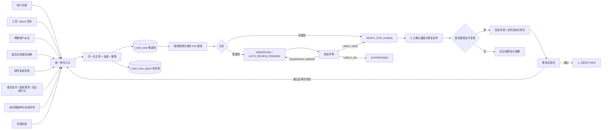
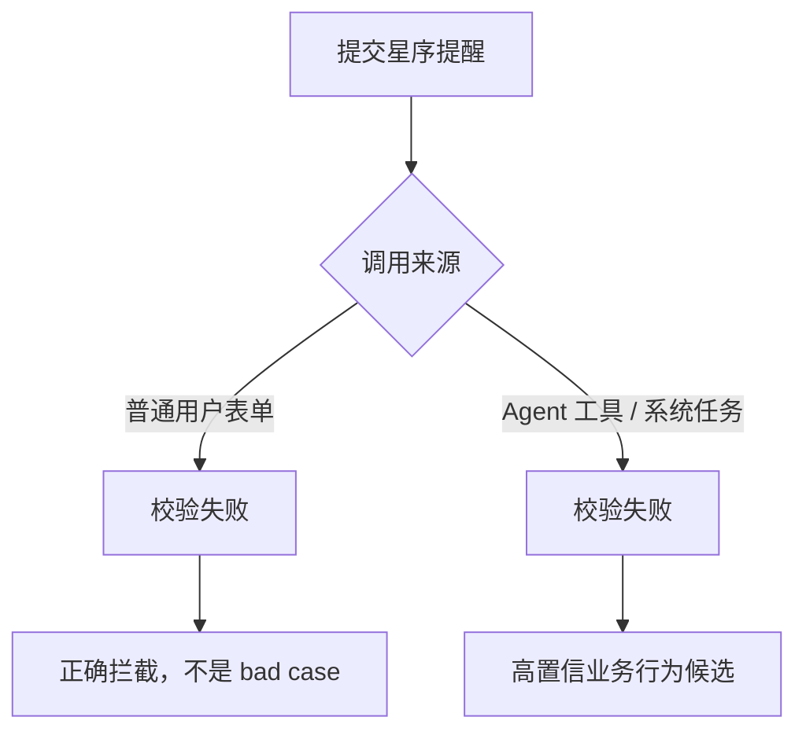
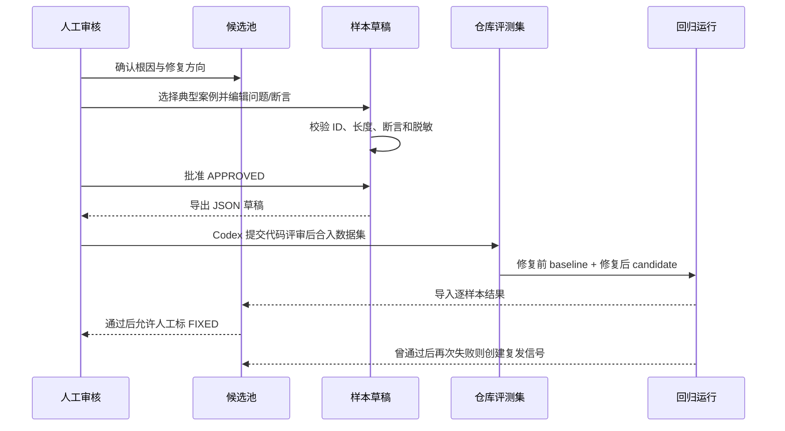

# Bad Case 统一候选池与分级入口技术方案

> 文档状态：交付 Codex 实施的设计稿
>
> 核查日期：2026-10-25
>
> 适用范围：starlineAgent 的 Agent 会话、星序活动提醒、bad case 管理后台、现有 Agent 评测框架
>
> 实施约束：本文档只描述改造方案；本次未修改任何业务代码、数据库或服务器配置。

---

## 0. 目标、非目标与核心结论

### 0.1 目标

把当前只有「用户点踩」的 bad case 入口，扩展为覆盖以下信号的统一候选池：

1. **高置信入口**：工具/Agent 执行异常、明确用户纠正、星序业务规则违例、邮件发送失败。
2. **低置信行为信号**：重复追问、连续澄清、回答后无后续行为，以及来源与回答疑似不一致。
3. **主动补漏**：对未点踩的普通会话进行可复现抽样和自动评审。
4. **统一治理**：所有来源记录检测来源、规则、证据、置信度，按消息、运行、会话片段或业务对象去重。
5. **人工闭环**：机器只负责检测和分诊，人工确认是否为 bad case、根因和修复动作。
6. **回归闭环**：确认后的典型案例转成可重复执行的评测/测试样本，修复后回归，并监控是否复发。

### 0.2 非目标

- 不让 LLM 自动填写 `root_cause`，不让 LLM 自动把候选标成 `REVIEWED` 或 `FIXED`。
- 不因为「用户离开」「连续追问」就直接认定回答错误。
- 不把所有表单校验失败都当成系统 bad case。
- 不在生产管理后台直接改写仓库里的评测 JSON 文件。
- 不用词面重合度单独认定幻觉；不根据用户纠正内容直接断言用户一定正确。
- 不在第一期建设新的模型训练或「自动改提示词」系统。

### 0.3 核心结论

**保留并升级现有 `t_bad_case`，使其成为统一候选池；新增 `t_bad_case_signal` 保存每次检测信号。**

这样做比新建一套平行台账更适合当前项目：

- 现有 `BadCaseAnalyzer`、`BadCaseRules`、人工审核、修复记录和前端页面可以复用。
- 同一条回答同时出现「点踩 + 工具异常 + 用户纠正」时，只保留一个候选，下面挂三条信号。
- 邮件失败没有 `messageId`，通过通用 `subject_type + subject_id` 支持业务对象。
- `triage_status` 与 `review_status` 分离，避免低置信候选刷爆人工待办。

一句话记忆：

> **信号是“体检指标”，候选是“病历”，人工根因是“医生诊断”，评测样本是“出院后的复查项目”。**

---

## 1. 已核实的代码基线

### 1.1 当前建单入口

`BadCaseRepository.pendingFeedback()` 只查询：

```sql
WHERE f.vote = -1
  AND f.deleted = 0
  AND NOT EXISTS (
      SELECT 1 FROM t_bad_case b
      WHERE b.message_id = f.message_id AND b.user_id = f.user_id
  )
```

因此，未被点踩的异常、低质量回答和用户反复追问，目前都不会进入 `t_bad_case`。

`BadCaseScanJob` 当前每 5 分钟做增量扫描、每小时做历史补扫；`BadCaseAnalyzer` 负责现场快照，`BadCaseRules` 负责 R/A 线索，人工通过 `BadCaseService.review()` 填根因、修复动作和状态。

### 1.2 当前表和代码的几个硬约束

- `t_bad_case.message_id`、`conversation_id` 当前为 `NOT NULL`，邮件失败等无消息主体的事件无法自然落库。
- `t_bad_case.vote` 当前约束为 `vote = -1`，系统来源无法使用。
- 当前唯一键为 `(message_id, user_id)`，只能表达消息级去重。
- 当前 Agent 审计表为 `t_agent_run` / `t_agent_run_node`；`run_id` 实际是 `StreamTask taskId`，不是消息 ID。
- `AgentBadCaseMessageProvider` 优先按 `assistant_message_id` 精确关联运行审计；无审计时退化为消息 `blocks`。
- 审计采集状态有 `COMPLETE / PARTIAL / DISABLED`，采集不完整时不能做否定性结论。
- 工具块状态为 `pending/running/awaiting/done/failed/denied/interrupted`；审计节点成功状态是 `SUCCESS`。
- `denied` 表示工具体未执行；`interrupted` 可能涉及已发出的写操作，二者都不能简单当作普通工具异常。
- `AgentMessageStatus` 不能单独区分用户主动取消与系统异常。

### 1.3 星序业务基线

`StarlineEventService.create()` 已包含这些确定性校验：

- 信息状态只能是 `ANNOUNCED / TO_BE_ANNOUNCED`。
- 待公布记录不创建提醒。
- 已公布记录必须有活动名、来源名称、合法 HTTP(S) 来源链接。
- 必须显式确认来源内容一致。
- 开票时间、提醒时间必须晚于当前时间。
- 提醒时间不能晚于开票时间。
- 邮箱格式必须合法。

`StarlineReminderScheduler` 当前发送失败后只记录日志并把提醒置为 `FAILED`，没有接入 bad case，也没有结构化的失败原因和尝试次数。

**当前未发现星序创建提醒的 MCP/Agent 工具适配器。** 因此，Agent 业务规则违例的完整归因需要后续工具适配器传入 `runId/messageId`；不能假装现在已经存在这条调用链。

### 1.4 当前评测能力

`resources/regression/agent-memory-evaluation/` 已支持：

- JSON 数据集：`case -> turns`。
- 断言：`expectAll / expectAny / forbidAny / expectTools / forbidTools`。
- `phase = warmup / measure`，可把前序对话作为 warmup、目标轮作为 measure。
- 每次运行输出 `run.json / turns.jsonl / summary.json / report.md / turns.csv` 等。
- `EvaluationReportMain` 支持 baseline/candidate 比较，并校验数据和运行条件是否一致。

限制：

- 断言是确定性的字符串和工具名检查，不是通用事实裁判。
- 问题展开后不能超过 500 字符。
- 当前 runner 面向会话问答，不能直接验证 SMTP 邮件投递或星序 Service 校验。
- 对实时票务、当前时间等易变事实，没有固定工具数据和时间夹具时，不能直接沉淀为长期稳定断言。

---

## 2. 关键概念：四件事必须分开

| 概念               | 回答的问题          | 例子                                    | 谁决定      |
| ---------------- | -------------- | ------------------------------------- | -------- |
| 检测来源 `source`    | 从哪里发现的         | `AGENT_RUNTIME`、`STARLINE_DELIVERY`   | 检测器      |
| 检测规则 `rule_code` | 命中了哪条确定性或启发式规则 | `TOOL_FINAL_FAILED`、`REPEAT_QUESTION` | 检测器      |
| 置信度 `confidence` | 这个信号本身有多可靠     | 工具明确 `FAILED` 是高；用户离开是低               | 规则配置     |
| 严重度 `severity`   | 一旦成立影响有多大      | 邮件投递尝试失败且用户未收到提醒 S2；已恢复的工具异常 S4       | 规则 + 上下文 |
| 根因 `root_cause`  | 为什么发生、应该修哪里    | 检索失败、提示词缺约束、SMTP 认证失败                 | **人工**   |

重要原则：

1. **高置信不等于高严重度。** 一个已重试恢复的工具失败是高置信技术事件，但可能只是 S4。
2. **高置信不等于已确认 bad case。** 用户明确说“你错了”是高置信负反馈，但仍需人工核实是回答错、用户错，还是需求变化。
3. **低置信不等于无价值。** 低置信信号适合聚合、抽样和自动评审，不适合直接告警。
4. **自动评审不是人工根因。** 自动评审只能调整分诊状态，不能调用现有人工 `review()` 写根因。

---

## 3. 总体架构



### 3.1 两层状态，不混用

**`triage_status`：机器分诊状态**

- `OBSERVING`：低置信观察中，不进入默认人工待办。
- `AUTO_REVIEW_PENDING`：等待自动评审。
- `READY_FOR_HUMAN`：可以进入人工待办。
- `SUPPRESSED`：自动评审倾向正常或低价值，暂不展示；不是人工 `IGNORED`。

**`review_status`：人工处理状态，沿用现有值**

- `PENDING`
- `REVIEWED`
- `IGNORED`
- `FIXED`

禁止的隐式转换：

```text
自动评审 LIKELY_BAD  -X->  review_status=REVIEWED
自动评审 LIKELY_OK   -X->  review_status=IGNORED
回归一次通过         -X->  自动 review_status=FIXED（仍需人工确认修复记录）
```

---

## 4. 入口目录、置信度和处置动作

### 4.1 高置信入口

| 来源 / 规则                                       | 触发条件                                                    |       默认严重度 | 进入后的动作                     | 明确排除                       |
| --------------------------------------------- | ------------------------------------------------------- | ----------: | -------------------------- | -------------------------- |
| `AGENT_RUNTIME / AGENT_RUN_FAILED`            | 运行明确失败，或有系统错误块                                          |       S2/S3 | 立即建候选、保存运行快照、进入人工待办        | 用户主动取消                     |
| `AGENT_RUNTIME / TOOL_FINAL_FAILED`           | 工具节点最终状态为 `FAILED`                                      | S2；已恢复可降 S4 | 记录工具名、错误、入参摘要、是否重试恢复       | `DENIED`、单纯 `AWAITING`、空结果 |
| `USER_CORRECTION / EXPLICIT_USER_CORRECTION`  | 用户明确指出上一回答错误，并给出纠正对象或正确值                                |          S3 | 绑定被纠正的 assistant 消息，保存纠正原文 | “继续”“再问一个”、普通话题切换          |
| `STARLINE_BUSINESS / STARLINE_RULE_VIOLATION` | Agent 工具或系统任务违反确定性业务不变量                                 |       S2/S3 | 记录稳定 ruleCode、调用来源和参数摘要    | 普通用户表单被正确拦截                |
| `STARLINE_DELIVERY / MAIL_ATTEMPT_FAILED`     | `mailSender.send()` 明确抛异常，本次发送尝试失败（投递结果可能是“确定失败”或“不确定”） |          S2 | 立即建候选并纳入发送故障聚合告警           | 邮件已发送、仅页面展示失败              |
| `EVALUATION / EVAL_ASSERTION_FAILED`          | 确定性断言或工具断言失败                                            |          S3 | 关联数据集、case、turn、失败 checks  | 无断言的 unscored 轮            |
| `EVALUATION / REGRESSION_RECURRENCE`          | 某样本曾通过，后续同条件运行再次失败                                      |          S2 | 重新打开候选并关联两次运行证据            | 修复前持续失败，不称“复发”             |

高置信统一动作：

1. **新建候选时**写入 `triage_status=READY_FOR_HUMAN + review_status=PENDING`；已存在候选必须按 5.4 的状态矩阵处理，不能一概回退人工状态。
2. 保存完整但脱敏的现场快照；采集不完整时明确标 `PARTIAL/MISSING`。
3. 默认不调用 LLM 自动评审，节省成本；语义类高置信信号仍可人工复核。
4. 是否告警由 `severity + 聚合阈值` 决定，不是每条高置信都告警。
5. 不自动修复、不自动写根因、不直接加入评测集。

### 4.2 低置信入口

| 来源 / 规则                                             | 触发条件                     | 默认动作                | 不能直接得出的结论          |
| --------------------------------------------------- | ------------------------ | ------------------- | ------------------ |
| `CONVERSATION_BEHAVIOR / REPEAT_QUESTION`           | 同会话短时间重复或高度相似提问          | 低置信候选，聚合次数，可自动评审    | 用户重复问不一定因为回答错      |
| `CONVERSATION_BEHAVIOR / CONSECUTIVE_CLARIFICATION` | 连续多轮澄清且没有任务进展            | 低置信候选，只有达到轮次阈值才创建   | 必要澄清是正确行为          |
| `CONVERSATION_BEHAVIOR / NO_FOLLOWUP_AFTER_ANSWER`  | 回答后指定时间内无新用户消息/反馈        | 只进入观察池，默认不告警、不直接进人工 | 离开可能代表满意，不能称“失望放弃” |
| `AGENT_RUNTIME / EVIDENCE_ANSWER_MISMATCH`          | 回答与来源低重合，或自动评审发现疑似无依据/矛盾 | 低置信，必须结合证据完整性复核     | 词面不重合不等于幻觉         |
| `EVALUATION / EVAL_JUDGE_FAILED`                    | 模型裁判认为未通过                | 低置信，人工确认裁判是否可靠      | 模型裁判不是客观真值         |

低置信统一动作：

1. 可写候选，但默认 `OBSERVING` 或 `AUTO_REVIEW_PENDING`。
2. 不进入默认人工列表、不告警、不直接沉淀评测样本。
3. 自动评审为 `LIKELY_BAD` 后，只能提升为 `READY_FOR_HUMAN`，置信度仍保留 `LOW`，并展示“由自动评审提升”。
4. 自动评审为 `LIKELY_OK` 时置 `SUPPRESSED`，保留少量人工抽查以估计误判。
5. 多条弱信号可以丰富证据，但**不能简单相加后自动变成高置信**；只有新增一条高置信规则才升级候选为 `HIGH`。

---

## 5. 统一主体与去重策略

### 5.1 主体类型

| `subject_type`         | `subject_id`            | 用途                      |
| ---------------------- | ----------------------- | ----------------------- |
| `AGENT_MESSAGE`        | assistant messageId     | 大多数问答、工具、纠正、来源一致性       |
| `RAG_MESSAGE`          | RAG assistant messageId | 兼容现有点踩和 RAG 线索          |
| `AGENT_RUN`            | runId                   | 运行已失败但 assistant 消息尚未落库 |
| `CONVERSATION_EPISODE` | 稳定的会话片段 ID              | 连续澄清等跨轮行为               |
| `STARLINE_REMINDER`    | eventId                 | 邮件发送失败、提醒业务异常           |
| `STARLINE_RULE`        | 规则 + 请求指纹               | 尚未生成 eventId 的业务规则违例    |
| `EVAL_TURN`            | 数据集/case/turn 哈希        | 评测失败和复发                 |

候选尽量绑定“出问题的那条 assistant 回答”，不要把重复追问信号绑到后来那条 user 消息上。

当运行失败且消息尚未落库时，先建 `AGENT_RUN` 候选；后续发现 `assistant_message_id` 后，通过归并逻辑把主体补充为消息，不能生成第二张重复工单。

### 5.2 `dedup_key` 规则

只有 `BadCaseDedupPolicy` 可以生成 key，检测器不得各自拼接一套格式。

| 场景        | key                                                                                    |
| --------- | -------------------------------------------------------------------------------------- |
| 消息级信号     | `MSG:<messageId>`                                                                      |
| 只有运行的异常   | `RUN:<runId>`                                                                          |
| 星序提醒      | `STARLINE_REMINDER:<eventId>`                                                          |
| 连续澄清片段    | `CONV:<conversationId>:CLARIFY:<episodeStartMessageId>`                                |
| 无消息业务规则违例 | `STARLINE_RULE:<sha256(userId+ruleCode+normalizedRequest+timeBucket)>`                 |
| 评测 turn   | `EVAL:<sha256(datasetTurnFingerprint+caseId+turnId)>`；同一逻辑 turn 的多个 repetition 聚合到同一候选 |

效果：

- 同一 assistant 消息的点踩、工具异常、用户纠正、抽样评审共用 `MSG:<messageId>`，合并为一个候选。
- 同一提醒的多次发送失败共用 `STARLINE_REMINDER:<eventId>`，增加信号次数而不是刷屏。
- 连续澄清按“片段”去重，不是整个会话永远只能有一张单。

`datasetTurnFingerprint` 必须是**单个 case/turn 的规范内容指纹**，包含问题、断言和与结果有关的配置；不能直接拿整文件 hash 或整次选择集 hash 代替。`repetition` 只进入 occurrence 和运行结果主键，不为每次重复生成一个逻辑候选。

### 5.3 信号自身的幂等键

候选去重与信号幂等不是一回事：

- `dedup_key` 决定“挂在哪张候选下”。
- `(rule_code, occurrence_key)` 决定“这一次检测是否已经记录过”。

示例：

| 信号   | `occurrence_key`                              |
| ---- | --------------------------------------------- |
| 点踩   | `feedback:<messageId>:<userId>`               |
| 工具异常 | `tool:<runId>:<nodeId>`                       |
| 用户纠正 | `correction:<correctionMessageId>`            |
| 邮件失败 | `mail:<eventId>:<attemptCount>`               |
| 重复追问 | `repeat:<laterUserMessageId>`                 |
| 抽样   | `sample:<batchId>:<messageId>`                |
| 评测失败 | `eval:<runId>:<caseId>:<turnId>:<repetition>` |

重复执行扫描、消息重发或多个实例同时运行时，同一信号只能插入一次。

### 5.4 合并、人工状态转换与解档重开

- 新信号插入成功后，候选的有效 `signal_count` 重新统计，`last_detected_at` 更新；失效信号只留痕，不计入有效信号。
- 只要存在一个有效高置信信号，候选就是 `HIGH`；低置信数量不会把候选“堆成”高置信。
- `primary_source` 按固定优先级选取：用户明确反馈/业务交付失败/运行异常/评测/行为/抽样。
- 所有合并、重开都增加 `revision`，继续沿用乐观锁。
- 自动评审只处理 `deleted=0 + review_status=PENDING + triage_status IN (OBSERVING,AUTO_REVIEW_PENDING)` 的候选，绝不触碰已人工审核记录。

**人工状态转换矩阵：**

| 当前状态        | 新普通低置信信号  | 新高置信信号                              | 处理方式                            |
| ----------- | --------- | ----------------------------------- | ------------------------------- |
| `PENDING`   | 追加信号并重新分诊 | 追加信号并置 READY                        | 不改变人工根因字段                       |
| `REVIEWED`  | 只追加信号     | 只追加信号并提示“审核后有新证据”                   | **不得回退为 PENDING**，由人决定是否另开或重新审核 |
| `IGNORED`   | 同规则只留痕    | 相同规则默认只留痕；不同规则或更高严重度可建议重开           | 重开必须由明确策略或人工触发                  |
| `FIXED` 未归档 | 只追加信号     | occurrence 晚于上次完成时间才重开              | 先保存上一轮审核历史，再清空上一轮修复字段           |
| `FIXED` 已归档 | 只追加信号，不解档 | occurrence 晚于 `archived_at` 才允许解档重开 | 旧扫描重放绝不能解档                      |

**重开/解档必须在同一事务中完成：**

1. 向 `t_bad_case_review_log` 写入上一轮 `root_cause/fix_action/reviewer/review_time` 等完整快照，动作记为 `REOPEN`。
2. 主表改为 `PENDING + READY_FOR_HUMAN`，清空上一轮 `root_cause/root_cause_detail/fix_action/fix_ref/fix_note/reviewer/review_time`，防止旧结论被误当成本轮结论。
3. `snapshot_status=PENDING`，重新 enrich；已归档记录的问答和快照已被清空，不能只做 `deleted=0` 就结束。
4. 已归档记录同时设置 `deleted=0, archived_at=NULL`；重开后 `revision=revision+1`。
5. 重开条件中的时间比较使用信号的**实际发生时间**，不是扫描或导入时间。


历史 `REVIEWED` 收到新信号时，如果产品决定允许人工重开，也应走同一套“保存审核历史 + 清空本轮字段”的路径，而不是直接覆盖状态。

---

## 6. 数据库改造

> 建议新增 `resources/database/migrations/20261025_bad_case_candidate_pool.sql`。
> 以下为参考 DDL，Codex 需在测试库根据实际约束名和数据量调整；生产执行前先备份并验证迁移。

### 6.1 升级 `t_bad_case` 为统一候选池

```sql
BEGIN;
SET LOCAL lock_timeout = '10s';

ALTER TABLE t_bad_case ALTER COLUMN message_id DROP NOT NULL;
ALTER TABLE t_bad_case ALTER COLUMN conversation_id DROP NOT NULL;

ALTER TABLE t_bad_case ADD COLUMN IF NOT EXISTS subject_type VARCHAR(32);
ALTER TABLE t_bad_case ADD COLUMN IF NOT EXISTS subject_id VARCHAR(64);
ALTER TABLE t_bad_case ADD COLUMN IF NOT EXISTS dedup_key VARCHAR(160);
ALTER TABLE t_bad_case ADD COLUMN IF NOT EXISTS title VARCHAR(255);
ALTER TABLE t_bad_case ADD COLUMN IF NOT EXISTS primary_source VARCHAR(32);
ALTER TABLE t_bad_case ADD COLUMN IF NOT EXISTS confidence VARCHAR(8);
ALTER TABLE t_bad_case ADD COLUMN IF NOT EXISTS severity VARCHAR(4);
ALTER TABLE t_bad_case ADD COLUMN IF NOT EXISTS triage_status VARCHAR(24);
ALTER TABLE t_bad_case ADD COLUMN IF NOT EXISTS signal_count INTEGER NOT NULL DEFAULT 0;
ALTER TABLE t_bad_case ADD COLUMN IF NOT EXISTS first_detected_at TIMESTAMP;
ALTER TABLE t_bad_case ADD COLUMN IF NOT EXISTS last_detected_at TIMESTAMP;
ALTER TABLE t_bad_case ADD COLUMN IF NOT EXISTS snapshot_status VARCHAR(16) NOT NULL DEFAULT 'PENDING';
ALTER TABLE t_bad_case ADD COLUMN IF NOT EXISTS auto_review_result JSONB;
ALTER TABLE t_bad_case ADD COLUMN IF NOT EXISTS auto_review_model VARCHAR(64);
ALTER TABLE t_bad_case ADD COLUMN IF NOT EXISTS auto_reviewed_at TIMESTAMP;
ALTER TABLE t_bad_case ADD COLUMN IF NOT EXISTS suppressed_reason VARCHAR(512);
ALTER TABLE t_bad_case ADD COLUMN IF NOT EXISTS archived_at TIMESTAMP;

UPDATE t_bad_case
SET subject_type = CASE WHEN message_type = 'AGENT' THEN 'AGENT_MESSAGE' ELSE 'RAG_MESSAGE' END,
    subject_id = message_id,
    dedup_key = 'MSG:' || message_id,
    title = left(coalesce(nullif(user_question, ''), 'bad case'), 255),
    primary_source = 'USER_FEEDBACK',
    confidence = 'HIGH',
    severity = 'S3',
    triage_status = 'READY_FOR_HUMAN',
    signal_count = 1,
    first_detected_at = create_time,
    last_detected_at = create_time,
    snapshot_status = CASE
        WHEN message_type = 'UNKNOWN' OR message_status = 'MISSING' THEN 'MISSING'
        ELSE 'PARTIAL'
    END,
    archived_at = CASE WHEN deleted = 1 THEN update_time ELSE NULL END
WHERE subject_id IS NULL;

ALTER TABLE t_bad_case ALTER COLUMN subject_type SET NOT NULL;
ALTER TABLE t_bad_case ALTER COLUMN subject_id SET NOT NULL;
ALTER TABLE t_bad_case ALTER COLUMN dedup_key SET NOT NULL;
ALTER TABLE t_bad_case ALTER COLUMN primary_source SET NOT NULL;
ALTER TABLE t_bad_case ALTER COLUMN confidence SET NOT NULL;
ALTER TABLE t_bad_case ALTER COLUMN severity SET NOT NULL;
ALTER TABLE t_bad_case ALTER COLUMN triage_status SET NOT NULL;

ALTER TABLE t_bad_case DROP CONSTRAINT IF EXISTS t_bad_case_vote_check;
ALTER TABLE t_bad_case ALTER COLUMN vote SET DEFAULT 0;
ALTER TABLE t_bad_case ADD CONSTRAINT t_bad_case_vote_check CHECK (vote IN (-1, 0));
ALTER TABLE t_bad_case ADD CONSTRAINT t_bad_case_confidence_check
    CHECK (confidence IN ('HIGH','LOW'));
ALTER TABLE t_bad_case ADD CONSTRAINT t_bad_case_severity_check
    CHECK (severity IN ('S1','S2','S3','S4'));
ALTER TABLE t_bad_case ADD CONSTRAINT t_bad_case_triage_check
    CHECK (triage_status IN ('OBSERVING','AUTO_REVIEW_PENDING','READY_FOR_HUMAN','SUPPRESSED'));
ALTER TABLE t_bad_case ADD CONSTRAINT t_bad_case_snapshot_check
    CHECK (snapshot_status IN ('PENDING','COMPLETE','PARTIAL','MISSING'));
ALTER TABLE t_bad_case ADD CONSTRAINT uk_bad_case_dedup UNIQUE (dedup_key);

CREATE INDEX IF NOT EXISTS idx_bad_case_triage
    ON t_bad_case (triage_status, confidence, severity, last_detected_at DESC)
    WHERE deleted = 0;
CREATE INDEX IF NOT EXISTS idx_bad_case_subject
    ON t_bad_case (subject_type, subject_id);
CREATE INDEX IF NOT EXISTS idx_bad_case_primary_source
    ON t_bad_case (primary_source, create_time DESC) WHERE deleted = 0;

COMMENT ON COLUMN t_bad_case.confidence IS '检测信号可信度，不是人工根因置信度，也不是统计概率';
COMMENT ON COLUMN t_bad_case.triage_status IS '机器分诊状态，与人工 review_status 分离';
COMMIT;
```

说明：

- 保留现有 `(message_id, user_id)` 唯一键和归档墓碑语义；非消息主体使用 NULL，PostgreSQL 唯一键中的多个 NULL 不冲突。
- 原有记录全部回填为点踩来源、高置信、待人工分诊，行为保持兼容；同时补插历史点踩信号，保证 `signal_count` 与时间线一致。
- 历史快照没有可靠的完整度证明，保守回填为 `PARTIAL`；明确缺失的为 `MISSING`。只有重新 enrich 验证后才能改为 `COMPLETE`。
- 现有归档逻辑必须同步写入 `archived_at=CURRENT_TIMESTAMP`；老归档数据用归档时的 `update_time` 回填。
- 实际环境若 check 约束名不同，先查询 `\d t_bad_case`，不要盲目执行。

### 6.2 新增信号表

```sql
CREATE TABLE IF NOT EXISTS t_bad_case_signal (
    id VARCHAR(20) NOT NULL PRIMARY KEY,
    bad_case_id VARCHAR(20) NOT NULL REFERENCES t_bad_case(id),
    source VARCHAR(32) NOT NULL,
    rule_code VARCHAR(64) NOT NULL,
    confidence VARCHAR(8) NOT NULL CHECK (confidence IN ('HIGH','LOW')),
    severity VARCHAR(4) NOT NULL CHECK (severity IN ('S1','S2','S3','S4')),
    occurrence_key VARCHAR(160) NOT NULL,
    evidence JSONB NOT NULL DEFAULT '{}'::jsonb,
    detector_version VARCHAR(32) NOT NULL,
    occurred_at TIMESTAMP NOT NULL,
    invalidated_at TIMESTAMP,
    invalid_reason VARCHAR(255),
    create_time TIMESTAMP NOT NULL DEFAULT CURRENT_TIMESTAMP,
    CONSTRAINT uk_bad_case_signal_occurrence UNIQUE (rule_code, occurrence_key)
);

CREATE INDEX IF NOT EXISTS idx_bad_case_signal_case
    ON t_bad_case_signal (bad_case_id, occurred_at DESC);
CREATE INDEX IF NOT EXISTS idx_bad_case_signal_rule
    ON t_bad_case_signal (source, rule_code, occurred_at DESC);

-- 历史点踩也必须补一条信号，不能只回填 signal_count。
INSERT INTO t_bad_case_signal
    (id,bad_case_id,source,rule_code,confidence,severity,occurrence_key,
     evidence,detector_version,occurred_at)
SELECT b.id,b.id,'USER_FEEDBACK','USER_DOWNVOTE','HIGH','S3',
       'feedback:' || b.message_id || ':' || b.user_id,
       jsonb_build_object('legacyBackfill',true,'reason',b.reason,'comment',b.comment),
       'legacy-v1',b.create_time
FROM t_bad_case b
WHERE b.message_id IS NOT NULL
ON CONFLICT (rule_code,occurrence_key) DO NOTHING;

UPDATE t_bad_case b
SET signal_count = (
    SELECT count(*) FROM t_bad_case_signal s
    WHERE s.bad_case_id = b.id AND s.invalidated_at IS NULL
);

CREATE TABLE IF NOT EXISTS t_bad_case_review_log (
    id VARCHAR(20) NOT NULL PRIMARY KEY,
    bad_case_id VARCHAR(20) NOT NULL REFERENCES t_bad_case(id),
    action VARCHAR(16) NOT NULL,
    root_cause VARCHAR(32),
    root_cause_detail VARCHAR(1024),
    fix_action VARCHAR(32),
    fix_ref VARCHAR(128),
    fix_note VARCHAR(1024),
    review_status VARCHAR(16) NOT NULL,
    reviewer VARCHAR(64),
    review_time TIMESTAMP,
    revision BIGINT NOT NULL,
    create_time TIMESTAMP NOT NULL DEFAULT CURRENT_TIMESTAMP
);
CREATE INDEX IF NOT EXISTS idx_bad_case_review_log_case
    ON t_bad_case_review_log (bad_case_id, create_time DESC);
```

`evidence` 只存判定所需的最小证据，默认单条不超过 32KB；完整运行现场仍由现有快照和 Agent 审计承担。

信号失效是信号级操作：后续行为使 `NO_FOLLOWUP_AFTER_ANSWER` 失效时，更新该信号的 `invalidated_at/invalid_reason`，统计和自动评审输入都过滤 `invalidated_at IS NOT NULL`。如果同一候选还有点踩或工具异常，其他信号和候选分诊状态不受影响；只有全部有效信号都失效时，才可把候选置为 `SUPPRESSED`。

人工每次审核、重开和解档都追加 `t_bad_case_review_log`，主表只保存本轮最新结论。

### 6.3 抽样批次表

```sql
CREATE TABLE IF NOT EXISTS t_bad_case_sample_batch (
    id VARCHAR(20) NOT NULL PRIMARY KEY,
    sample_date DATE NOT NULL,
    engine VARCHAR(16) NOT NULL,
    purpose VARCHAR(16) NOT NULL CHECK (purpose IN ('DISCOVERY','MEASUREMENT')),
    stratum_key VARCHAR(64) NOT NULL DEFAULT 'ALL',
    rate_bp INTEGER NOT NULL,
    seed VARCHAR(64) NOT NULL,
    frame_count INTEGER NOT NULL DEFAULT 0,
    selected_count INTEGER NOT NULL DEFAULT 0,
    inclusion_probability NUMERIC(12,11),
    frame_high_water JSONB NOT NULL,
    frame_definition_hash VARCHAR(64) NOT NULL,
    status VARCHAR(16) NOT NULL DEFAULT 'RUNNING',
    create_time TIMESTAMP NOT NULL DEFAULT CURRENT_TIMESTAMP,
    CONSTRAINT uk_bad_case_sample_batch
        UNIQUE (sample_date, engine, purpose, stratum_key)
);
```

保留抽样框、比例和随机种子，才能复现样本、解释覆盖率并计算加权指标。

### 6.4 评测样本关联表

```sql
CREATE TABLE IF NOT EXISTS t_bad_case_eval_sample (
    id VARCHAR(20) NOT NULL PRIMARY KEY,
    bad_case_id VARCHAR(20) NOT NULL REFERENCES t_bad_case(id),
    case_id VARCHAR(128) NOT NULL,
    dataset_name VARCHAR(128) NOT NULL DEFAULT 'bad-case-regression',
    tags JSONB NOT NULL DEFAULT '[]'::jsonb,
    description TEXT,
    turns JSONB NOT NULL,
    test_lane VARCHAR(24) NOT NULL DEFAULT 'CONVERSATION'
        CHECK (test_lane IN ('CONVERSATION','SERVICE_TEST','INTEGRATION_TEST')),
    status VARCHAR(16) NOT NULL DEFAULT 'DRAFT'
        CHECK (status IN ('DRAFT','APPROVED','EXPORTED','RETIRED')),
    dataset_fingerprint VARCHAR(64),
    last_run_id VARCHAR(64),
    last_result VARCHAR(16),
    last_run_finished_at TIMESTAMP,
    recurrence_count INTEGER NOT NULL DEFAULT 0,
    created_by VARCHAR(64),
    reviewer VARCHAR(64),
    revision BIGINT NOT NULL DEFAULT 0,
    create_time TIMESTAMP NOT NULL DEFAULT CURRENT_TIMESTAMP,
    update_time TIMESTAMP NOT NULL DEFAULT CURRENT_TIMESTAMP,
    CONSTRAINT uk_bad_case_eval_case UNIQUE (dataset_name, case_id)
);

CREATE TABLE IF NOT EXISTS t_bad_case_eval_result (
    id VARCHAR(20) NOT NULL PRIMARY KEY,
    sample_id VARCHAR(20) NOT NULL REFERENCES t_bad_case_eval_sample(id),
    run_id VARCHAR(64) NOT NULL,
    case_id VARCHAR(128) NOT NULL,
    turn_id VARCHAR(128) NOT NULL,
    repetition INTEGER NOT NULL,
    dataset_turn_fingerprint VARCHAR(64) NOT NULL,
    turn_status VARCHAR(16) NOT NULL,
    scored SMALLINT NOT NULL,
    passed SMALLINT,
    failure_class VARCHAR(64),
    checks JSONB,
    run_finished_at TIMESTAMP NOT NULL,
    raw_result JSONB,
    create_time TIMESTAMP NOT NULL DEFAULT CURRENT_TIMESTAMP,
    CONSTRAINT uk_bad_case_eval_result_turn
        UNIQUE (run_id, case_id, turn_id, repetition)
);
CREATE INDEX IF NOT EXISTS idx_bad_case_eval_result_sample
    ON t_bad_case_eval_result (sample_id, run_finished_at DESC);
```

### 6.5 星序提醒失败信息

建议新增 `20261025_starline_delivery_failure.sql`：

```sql
ALTER TABLE t_starline_event_reminder
    ADD COLUMN IF NOT EXISTS attempt_count INTEGER NOT NULL DEFAULT 0,
    ADD COLUMN IF NOT EXISTS last_error_code VARCHAR(64),
    ADD COLUMN IF NOT EXISTS last_error_message VARCHAR(1024),
    ADD COLUMN IF NOT EXISTS last_delivery_outcome VARCHAR(16),
    ADD COLUMN IF NOT EXISTS failed_at TIMESTAMP;

CREATE INDEX IF NOT EXISTS idx_starline_failed_reminders
    ON t_starline_event_reminder (failed_at, id)
    WHERE reminder_status = 'FAILED';
```


`last_error_message` 只能保存脱敏、截断后的技术错误，不得保存邮箱密码、SMTP 凭据、完整请求头或收件人原文。

---

## 7. 统一接入契约与模块边界

### 7.1 在 framework 放窄接口，避免模块反向依赖

当前依赖关系是 `agent -> rag`、`starline -> system -> framework`。不能让星序直接依赖 rag 的具体实现。

建议在 framework 新增纯 DTO 和 SPI：

```java
public record BadCaseSignal(
        String source,
        String ruleCode,
        String confidence,
        String severity,
        String subjectType,
        String subjectId,
        String messageId,
        String conversationId,
        String userId,
        String runId,
        String occurrenceKey,
        String title,
        Instant occurredAt,
        String detectorVersion,
        Map<String, Object> evidence
) {}

public interface BadCaseIntake {
    IntakeResult submit(BadCaseSignal signal);
    void submitSafely(BadCaseSignal signal); // 不向上抛异常，不影响业务主流程
}

public interface BadCaseDetector {
    String detectorCode();
    DetectorScanResult scan(BadCaseScanContext context);
}
```

- `submit()` 在编排任务中同步、事务化调用。
- `submitSafely()` 用于业务边界，只 best-effort；内部捕获并记录日志，不能改变业务返回值或异常。
- 检测器实现可位于 agent、starline 或 rag；rag 的 `BadCaseScanJob` 通过 `List<BadCaseDetector>` 统一编排，无需编译期依赖 agent/starline。
- `BadCaseDedupPolicy` 是唯一生成 `dedup_key` 的地方。

### 7.2 推荐组件

| 组件 | 职责 |
|---|---|
| `BadCaseIntakeService` | 校验信号、去重、写候选与信号、合并置信度、处理重开 |
| `BadCaseEvidenceEnricher` | 根据主体补现场快照；消息主体复用 `BadCaseAnalyzer` |
| `BadCaseAutoReviewService` | 只对低置信候选项做结构化评审，更新 triage，不写根因 |
| `BadCaseEvalSampleService` | 样本草稿、校验、导出和回归结果关联 |
| `AgentRuntimeBadCaseDetector` | 扫描运行/工具异常、纠正和行为信号 |
| `StarlineBadCaseDetector` | 扫描邮件失败；接收业务规则违例事件 |
| `UnvotedSampleDetector` | 构建未点踩抽样框并提交样本 |
| `BadCaseAlertService` | 按严重度和聚合规则告警，与候选建单解耦 |

### 7.3 两阶段处理：先检测，后补现场

业务信号到达时，assistant 消息或运行节点可能尚未完全落库。因此：

1. `intake` 先可靠写入信号和最小候选，`snapshot_status=PENDING`。
2. `enrich` 在消息/运行终态后读取快照，执行现有 `BadCaseRules`。
3. 能关联消息时复用 `AgentBadCaseMessageProvider`；采集不完整时标 `PARTIAL`。
4. 多次补现场仍找不到主体时标 `MISSING`，保留信号，不伪造就绪快照。
5. `PARTIAL / DISABLED` 的自动评审只能返回 `UNCERTAIN`，不能因“没看到错误”而返回 `LIKELY_OK`。

---

## 8. 高置信入口详细设计

### 8.1 工具与 Agent 执行异常

#### 数据来源

优先使用运行审计：

```sql
SELECT r.run_id, r.assistant_message_id, r.conversation_id, r.user_id,
       r.capture_status, n.node_id, n.node_name, n.status,
       n.error_message, n.input_payload, n.output_payload, n.started_at
FROM t_agent_run_node n
JOIN t_agent_run r ON r.run_id = n.run_id
WHERE n.node_type = 'TOOL'
  AND n.status = 'FAILED'
  AND r.run_status IN ('NORMAL','INTERRUPTED','FAILED')
  AND n.ended_at >= ?                 -- 有限回看窗口
  AND n.ended_at <= ?                 -- 本批封闭上界，排除未稳定的新事件
  AND (n.ended_at > ?
       OR (n.ended_at = ? AND n.id > ?)) -- (ended_at,id) 复合游标
ORDER BY n.ended_at, n.id
LIMIT ?;
```

同时扫描 `t_agent_run.run_status='FAILED'` 或有明确系统错误的运行。

主扫描必须保存 `(ended_at,id)` 复合游标，不能只保存时间戳；否则同一时间戳节点超过批量上限时会停在同一页。每批使用封闭上界，并给审计落库留短暂稳定时间。另设有限回看补扫：以 `NOT EXISTS` 对应信号为条件扫描近期窗口，接住晚于游标写入的旧时间戳节点。幂等键只负责不重复入库，**不能代替游标推进和迟到数据补扫**。

#### 判定规则

- `TOOL_FINAL_FAILED`：工具最终 `FAILED`，高置信。
- `AGENT_RUN_FAILED`：运行明确失败，高置信。
- `TOOL_TRANSIENT_FAILED`：同一运行中后续同工具成功，仍记录客观失败，但 `severity=S4`，不告警。
- `DENIED`：不进入工具异常候选；若是业务规则拒绝，走独立业务规则入口。
- `AWAITING`：不是异常。
- `INTERRUPTED`：必须结合运行失败原因；不能仅凭中断建高置信。
- 空结果、未找到资料：不是工具执行异常，保留 A8 等低置信语义。

#### 证据示例

```json
{
  "toolName": "search_knowledge",
  "runId": "01J...",
  "nodeId": "tool-3",
  "errorCode": "UPSTREAM_TIMEOUT",
  "errorMessage": "检索服务 10s 超时",
  "recovered": false,
  "captureStatus": "COMPLETE",
  "inputSummary": {"query": "周杰伦上海站开票时间"}
}
```

工具入参必须脱敏和截断；不能复制认证 header、用户隐私或完整长文档。

### 8.2 明确用户纠正

#### 绑定目标

对每条新的 user 消息，在同会话向前找最近的 assistant 消息；有精确关系时优先使用消息关联，没有时间关系时再用 `create_time + id` 排序。候选绑定被纠正的 assistant 消息，证据中保存 correctionMessageId。

#### 高分规则

必须同时满足：

1. 存在可绑定的前一条 assistant 回答。
2. 用户消息包含明确否定/纠正指向，例如“你错了”“不对，应该是…”“不是 A，是 B”“更正一下刚才…”。
3. 能识别纠正对象、被替换值或明确指代“刚才/你上面说的”。
4. 不命中排除语境，例如“不是说你错了”“没错”“不用纠正”。

示例：

```text
 assistant：开票时间是明天 10:00。
 user：不对，我刚才看官方写的是明天 12:00，你把时间改过来。
```

这是高置信的“上一回答被用户明确否定”信号，候选仍需人工核实官方证据。

以下只作低置信或不处理：

- “不对，再帮我查一下。”——有否定但没有明确纠正对象，可降为普通负反馈。
- “不是周杰伦，我想问林俊杰。”——若属于主动换话题而非纠正，不应误报。
- “继续”“再详细一点”“然后呢”——不是纠正。

#### 实现建议

- 第一期使用可测试的规则分类器，不直接让 LLM 决定 HIGH。
- 规则命中后，自动评审只负责补充语义摘要，不改变 HIGH 的来源。
- `UserCorrectionDetector` 先于 `RepeatQuestionDetector` 执行；重复检测排除已判为明确纠正的消息。

### 8.3 星序业务规则违例

#### 必须区分的两种情况



普通用户输入过去的开票时间，Service 正确拒绝，是系统正常工作；Agent 已在工具说明中知道“提醒时间不能晚于开票时间”，仍提交非法参数，才是需要修复提示词、参数生成或工具 Schema 的候选。

#### 稳定错误码

不要靠匹配“提醒时间不能晚于开票时间”等中文文案检测。新增 `StarlineRuleViolationException extends ClientException`，增加 `ruleCode`，或引入统一 `StarlineRuleValidator` 输出稳定 violation：

| ruleCode | 当前校验 |
|---|---|
| `INVALID_INFO_STATUS` | 信息状态非法 |
| `ANNOUNCED_EVENT_NAME_REQUIRED` | 已公布缺活动名 |
| `ANNOUNCED_SOURCE_REQUIRED` | 已公布缺来源 |
| `SOURCE_NOT_CONFIRMED` | 未确认来源一致 |
| `TICKET_TIME_NOT_FUTURE` | 开票时间不在未来 |
| `REMIND_TIME_NOT_FUTURE` | 提醒时间不在未来 |
| `REMIND_AFTER_TICKET` | 提醒晚于开票 |
| `INVALID_SOURCE_URL` | 来源 URL 非法 |
| `INVALID_EMAIL` | 邮箱格式非法 |

#### 调用来源上下文

新增 `StarlineInvocationContext`，至少包含：

```java
public record StarlineInvocationContext(
        String origin,       // USER_FORM / AGENT_TOOL / SYSTEM_JOB
        String runId,
        String messageId,
        String conversationId
) {}
```

- Controller 普通表单默认为 `USER_FORM`，不建候选。
- 未来星序 Agent/MCP 工具适配器必须在 `try/finally` 中设置并清理 `AGENT_TOOL` 上下文，同时传 run/message/conversation。
- 只有 `AGENT_TOOL` 和 `SYSTEM_JOB` 的违例提交高置信信号。
- 当前尚无星序 Agent 工具，第一阶段需先用单元/集成测试验证上下文契约；生产端对 Agent 的全链路覆盖以工具适配器上线为准。

### 8.4 邮件发送失败

#### 拆开“发送失败”和“状态落库失败”

当前 `try` 同时包住 `mailSender.send()` 和 `service.mark()`。如果邮件已发成功、仅状态更新失败，不能把它记录成“邮件发送失败”。同时，`send()` 抛异常只能证明**本次发送尝试失败**：SMTP 认证/拒绝等能确定为“未投递”，而“服务器已接受邮件但连接随后断开”等场景，投递结果是不确定的，不能据此自动重发。

目标结构：

```java
try {
    mailSender.send(message);
} catch (Exception sendFailure) {
    // 记录 MAIL_ATTEMPT_FAILED，更新 FAILED 与脱敏错误，提交高置信信号
    continue;
}

try {
    service.markSent(event.getId(), sentAt);
} catch (Exception persistFailure) {
    // 记录 MAIL_STATUS_PERSIST_FAILED / SENDING 卡滞告警
    // 绝不能简单重发邮件
}
```

`claimForSending` 同时把 `attempt_count` 加一。`markSent` 清理错误字段；`markFailed` 写入 `failed_at`、错误码和脱敏错误摘要。

#### 候选与告警

- 候选：`subject_type=STARLINE_REMINDER`、`subject_id=eventId`。
- `occurrence_key=mail:<eventId>:<attemptCount>`，多次失败追加信号。
- `MAIL_ATTEMPT_FAILED` 默认 S2，因为用户任务“到点提醒”很可能没有完成。
- 用 `last_delivery_outcome` 区分结果：`FAILED` 表示确定未投递，`UNKNOWN` 表示尝试失败但结果不确定。`UNKNOWN` 禁止自动重发。
- 单条候选不必逐条打扰值班；建议 15 分钟内同错误码达到阈值再聚合告警。
- 增加 `SENDING` 超时看门狗，但不能在未确认投递结果时盲目重发。

---

## 9. 低置信行为信号详细设计

### 9.1 重复追问

建议条件：

1. 同会话、同用户、相邻或邻近用户问题。
2. 时间间隔不超过 10 分钟。
3. 词面二元组 Jaccard 达到初始阈值 0.82，或自动评审判定为“同一未解决诉求的复述”。
4. 前一轮已有 assistant 回答，不处于 `AWAITING_CONFIRM`。
5. 排除明确纠正、纯“继续/展开/下一步”、正常多轮补信息。

证据：

```json
{
  "firstQuestion": "林俊杰的生日是什么时候",
  "repeatQuestion": "那林俊杰生日是哪天",
  "similarity": 0.86,
  "intervalSeconds": 73,
  "targetAssistantMessageId": "..."
}
```

初始只置 `LOW + AUTO_REVIEW_PENDING`。重复次数作为排序依据，不能自动升级为 HIGH。

### 9.2 连续澄清

可观测启发式：

- assistant 连续提出澄清问题，例如“请问/你的意思是/需要…吗/请提供”。
- 连续至少 3 轮没有成功工具调用、没有任务完成标记、没有新信息槽位推进。
- 排除需要用户确认写操作的 `AWAITING_CONFIRM`，因为等待确认不是反复澄清。
- 排除用户明确要求“一次只问一个问题”的场景。

没有槽位跟踪时，不能声称“模型一直问同一个字段”；只能记录“连续澄清且无可见进展”，交自动评审和人工判断。

### 9.3 回答后无后续行为

当前数据库只能可靠判断：

> 某条 assistant 终态回答之后，经过 24 小时仍没有后续 user 消息或反馈。

这**不等于**“用户看到回答后立即放弃”，更不等于“用户因回答差而离开”。

因此第一期：

- 规则名使用 `NO_FOLLOWUP_AFTER_ANSWER`，不要在界面写成“用户失望离开”。
- 只生成 `LOW + OBSERVING` 的弱信号，不自动进入人工。
- 如果之后出现新用户消息，要把该弱信号标记为已失效，不再作为放弃证据。
- 大规模普通会话都有这个特征，必须受每日配额和抽样限制，不能全量建单。

若未来确实要研究“立即离开”，需新增前端匿名行为事件，如回答展示时长、页面关闭、会话切换；即使如此也只能是低置信信号。

### 9.4 来源与回答不一致

分两类：

**A. 现有 A4 等词面线索：始终低置信。**

`overlap(answer, toolOutput) < answerOverlapMin` 只能提示复核，不能证明无依据或幻觉。

**B. 结构化字段矛盾：满足严格条件时才可高置信。**

只有同时满足以下条件，才可另设 `SOURCE_FIELD_CONTRADICTION` 高置信规则：

- 来源与回答指向同一实体、同一活动、同一场次。
- 来源字段是结构化且经验证可信的字段。
- 字段可直接比较，如精确开票时间、明确状态。
- 无时间窗口、时区、场次等歧义。

当前 Agent 侧 `sources` 为空，工具结果也可能截断，因此第一期仍按低置信 + 自动评审实现，不提前宣称能做确定性事实矛盾判定。

---

## 10. 未点踩会话抽样与自动评审

### 10.1 抽样框

第一期建议只覆盖 Agent 终态回答，RAG 旧链路保留现有点踩入口。

纳入：

- assistant、未删除、运行已到终态。
- 消息已超过最小等待时间，例如 30 分钟，避免流式尚未结束。
- 没有任何 `vote=-1` 的反馈。
- 尚未被**人工或高置信候选**覆盖；已有低置信 `OBSERVING` 候选不排斥抽样，抽样信号合并到原候选即可。

排除：

- 测试/评测账号和内部管理员会话。
- `AWAITING_CONFIRM`、仍在运行、审计 `DISABLED` 且没有可用消息快照的记录。
- 已经 `READY_FOR_HUMAN` 或已被人工审核的高置信候选。

### 10.2 可复现抽样：冻结抽样框 + 固定样本量

不要使用不可复现的 `ORDER BY random()`，也不要在按阈值入样后再截断——一旦入样后被每日上限截断，最终入样概率就不再等于阈值，直接沿用 `1/p` 权重会得到有偏估计。

推荐流程：

1. **冻结抽样框**：确定起止高水位 `(create_time, id)`、引擎、分层键、过滤条件，计算 `frame_count`，并保存 `frame_definition_hash` 与 `frame_high_water`。
2. **分层（可选）**：按是否调用工具、耗时档等分层，每层单独记录 `frame_count` 和配额。
3. **固定样本量、无放回抽样**：对框内每行计算随机键 `score = sha256(seed + ":" + messageId)`，按 `score` 升序取前 `n` 条。`n = min(期望样本数, 该层配额)`，而不是“先按阈值全选再截断”。
4. **记录真实入样概率**：对某层，`inclusion_probability = selected_count / frame_count`，`sampleWeight = 1 / inclusion_probability`。
5. **证据落库**：写入 `batchId + stratumKey + inclusionProbability + sampleWeight`。

这样即使每日配额生效，每层的入样概率仍然可精确计算，MEASUREMENT 的加权估计不会失真。

- `rate_bp=200` 表示目标约 2%，最终 `n` 以冻结后的框和配额为准。
- 每日每类设置上限，防止高流量时成本和候选量失控。
- 抽样框和分层必须稳定，同一 `seed + 高水位` 可复现；不要边扫边改框。
- 流量差异大时按引擎、是否调用工具、耗时档分层，不能只抽“容易出错的会话”。

### 10.3 两种抽样目的必须分开

**DISCOVERY：发现更多候选**

- 自动评审全部样本。
- 只有 `LIKELY_BAD` 或指定复核比例进入人工。
- 用于补漏和找问题，不能直接计算整体 bad case 率。

**MEASUREMENT：测量漏报与裁判质量**

- 每周选取固定小样本，不论自动评审结果如何都进行人工检查。
- `LIKELY_OK` 也必须看，否则无法估计“自动评审漏掉了多少”。
- MEASUREMENT 样本的人工检查是独立的测量队列，不因自动评审返回 `LIKELY_OK` 而被跳过或压制。
- 只有这个样本结合真实 `inclusion_probability` 权重，才能估计未点踩会话的人工确认问题率。

如果不做 MEASUREMENT，只能汇报“新发现了多少候选”，不能宣称“漏报率下降了多少”。

### 10.4 自动评审输入与输出

输入：

- 用户问题、assistant 回答。
- 必要的近期对话，而不是整段无限历史。
- 工具名、状态、经截断的工具结果。
- 来源快照和 `captureStatus`。
- 行为信号及其数值。

安全约束：

- 评审模型无工具权限，不能执行用户/工具文本中的指令。
- 用户内容、检索内容作为不可信数据包裹，不把其中命令当系统提示。
- 限制输入长度；标注截断位置。
- 对邮箱、令牌、个人信息先脱敏。
- 使用独立提示词版本和模型配置，记录 `model + promptVersion`。

建议输出 JSON：

```json
{
  "verdict": "LIKELY_BAD",
  "issueTypes": ["UNSUPPORTED_ANSWER"],
  "rationale": "回答给出了明确开票时间，但工具结果中没有该时间。",
  "evidenceSpans": [
    {"side": "ANSWER", "text": "明天上午 10 点开票"},
    {"side": "TOOL", "text": "暂未查询到开票安排"}
  ],
  "uncertainties": ["尚未核验官方最新页面"],
  "suggestedChecks": ["确认工具是否完整返回", "核对官方开票时间"]
}
```

`verdict` 仅允许 `LIKELY_BAD / LIKELY_OK / UNCERTAIN`。

### 10.5 自动评审后的状态机

| 输出 | 动作 |
|---|---|
| `LIKELY_BAD` | `triage_status=READY_FOR_HUMAN`，保留 `confidence=LOW` |
| `LIKELY_OK` | `triage_status=SUPPRESSED`，记录理由；测量样本仍需人工 |
| `UNCERTAIN` | 回到 `OBSERVING`，可等待更多信号 |
| 调用失败/JSON 非法 | 有限重试后 `OBSERVING`，记录错误，不得当成 bad case |
| 证据采集不完整 | 强制 `UNCERTAIN`，不得因缺证据判正常 |


MEASUREMENT 样本例外：自动评审结果只写 `auto_review_result`，样本本身仍进入独立的测量人工队列，`LIKELY_OK` 不会被跳过，否则测量结论有偏。

自动评审结果写入 `auto_review_result`，界面必须标注“机器分诊建议，不是人工根因”。

---

## 11. 现有 R/A 规则如何纳入新体系

现有 `BadCaseRules` 不需要推倒重写。把它的输出视为候选的 `suspicions`，新增入口信号则进入 `t_bad_case_signal`。

建议初始分级：

| 现有规则 | 建议处理 |
|---|---|
| R1 明确节点 ERROR/FAILED | 可映射为高置信运行异常信号 |
| A2 知识检索工具失败 | 与 `TOOL_FINAL_FAILED` 合并，避免重复告警 |
| R2 INTERRUPTED | 默认低置信；只有明确系统失败原因才升级 |
| R3 REJECTED | 客观事件可记录，但需区分限流、准入和用户权限，不自动定根因 |
| R4/R5/R7/R8/R9/R10 | 低置信线索 |
| A1/A3/A4/A5/A6/A7/A8 | 低置信线索；A4 仍不得单独证明幻觉 |

避免同一事实重复计数的办法：

- R/A 规则负责生成解释性 `suspicions`。
- 新检测器负责生成带幂等键的 `signal`。
- 告警、入口数量和分级统计只看 `signal`，不要把 `suspicions` 文本再次当成独立入口计数。

---

## 12. 人工审核、根因与修复分类

### 12.1 保留现有人工审核约束

`BadCaseService.review()` 继续要求：

- `REVIEWED / FIXED` 必须有合法 `root_cause`。
- 必须携带 `revision`，避免并发覆盖。
- 修复动作必须属于合法枚举。
- 自动评审和检测器不得调用这个方法。

### 12.2 建议扩展枚举

`root_cause` 在现有七类上增加：

- `TOOL_EXECUTION`：工具实现、上游服务或调用协议异常。
- `BUSINESS_RULE`：Agent 未遵守业务约束或参数生成错误。
- `DELIVERY`：邮件、通知等交付链路失败。

`fix_action` 增加：

- `TOOL`：修工具实现、超时、重试、Schema。
- `BUSINESS_RULE`：修业务校验、参数约束或领域逻辑。
- `DELIVERY`：修 SMTP、投递配置、状态机。
- `EVAL_DATASET`：修错误或过时的评测样本本身。

不要把 `USER_CORRECTION`、`REPEAT_QUESTION` 加为根因；它们是症状/来源，不是根因。

### 12.3 人工队列排序

默认列表只显示：

```text
review_status = PENDING
AND triage_status = READY_FOR_HUMAN
AND deleted = 0
```

排序建议：严重度优先，其次用户明确反馈，再次最近发生时间；低置信自动提升项单独标识。

原始低置信池通过独立“候选池”视图查看，不与默认待办混在一起。

---

## 13. API 与后台页面改造

### 13.1 查询与详情

在现有 `/rag/bad-cases` 上扩展参数：

```text
reviewStatus
rootCause
triageStatus
confidence
source
severity
subjectType
page / size
```

为兼容现有页面，前端升级后默认显式传：

```text
reviewStatus=PENDING&triageStatus=READY_FOR_HUMAN
```

新增：

- `GET /rag/bad-cases/{id}/signals`：按时间列出全部信号、规则、证据和检测版本。
- `POST /rag/bad-cases/{id}/promote`：人工把低置信候选提升到待办，不写根因。
- `POST /rag/bad-cases/scan`：增加 `detector`、`mode=dryRun|apply`，支持单入口验证。
- `GET /rag/bad-cases/stats`：按 source/rule/confidence/triage 统计，SUPPRESSED 不计入活跃待办。

### 13.2 评测样本接口

- `POST /rag/bad-cases/{id}/eval-sample`：创建/更新样本草稿。
- `POST /rag/bad-cases/eval-samples/{sampleId}/approve`：人工批准样本定义。
- `GET /rag/bad-cases/eval-samples/export?datasetName=...`：导出经过校验的 JSON，不直接写生产服务器仓库。
- `POST /rag/bad-cases/eval-samples/import-result`：导入一次运行的摘要和逐样本结果，供复发检测。

所有接口继续要求 admin；导入接口使用独立受控凭据或仅允许受信内网/本机导入，不开放给普通用户。

### 13.3 前端页面

`BadCasePage.tsx`：

- 默认页改名“人工待办”，显示来源、置信度、严重度、信号数、最近发生时间。
- 新增“低置信候选”“抽样评审”“评测样本”视图。
- 统计卡不再只按 review_status，增加高置信待办、低置信待评审、今日合并信号数。

`BadCaseDetailDialog.tsx`：

- 增加“信号时间线”“自动评审”“评测与回归”区域。
- 非消息主体显示业务证据，不强制展示空的问题/回答。
- 只有 `messageId` 非空且类型为 AGENT 时才渲染 `AgentAuditByMessage`。
- 明确展示“高置信信号不等于人工已确认”。

`BadCaseReviewForm.tsx`：

- 补充新根因/修复动作。
- 有评测样本时显示最近回归结果和产物路径。
- `FIXED` 仍需人工点击；若样本最近失败，应阻止或强提示不能标 FIXED。

---

## 14. 典型案例沉淀与回归

### 14.1 不是所有 bad case 都适合进会话评测集

满足以下条件才沉淀：

1. 已人工确认根因，不只是自动信号。
2. 可稳定复现，期望结果明确。
3. 与现有样本不重复，具有代表性。
4. 已脱敏，问题不超过 runner 限制。
5. 不依赖会持续变化的实时网页、当前日期或未固定的外部工具结果。
6. 断言能够区分“修好”和“没修好”，不是只换一个说法就失败。

以下走其他测试通道：

| 案例类型 | 回归通道 |
|---|---|
| 回答错误、该查未查、纠正记忆、工具调用选择 | 现有 `CONVERSATION` JSON 评测 |
| 星序时间/来源等业务校验 | `SERVICE_TEST`：Service 参数化测试 |
| SMTP 抛异常、FAILED 状态、候选信号 | `INTEGRATION_TEST`：ReminderScheduler + fake/mock JavaMailSender |
| 去重、幂等、重开 | Repository/Service 集成测试 |
| 依赖实时票务事实的回答 | 先建设固定工具数据/时间夹具，再进入长期会话评测 |

### 14.2 样本生成流程



### 14.3 利用 warmup/measure 保留多轮上下文

对于“用户纠正后仍使用旧值”的案例：

- 前序轮作为 `warmup`，保留上下文但不参与评分。
- 被纠正后的目标轮作为 `measure`，添加期望新值、禁止旧值等断言。

示例：

```json
{
  "id": "bc-correction-budget-001",
  "tags": ["bad-case", "correction", "memory"],
  "description": "用户更正预算后，后续回忆只能使用新预算。",
  "turns": [
    {
      "id": "t01",
      "question": "我的预算是 5800 元，只咨询，不购买。",
      "phase": "warmup"
    },
    {
      "id": "t02",
      "question": "更正一下，预算改为 6500 元，旧预算作废。",
      "phase": "warmup"
    },
    {
      "id": "t03",
      "question": "只根据本次聊天回答：我现在的预算是多少？",
      "expectAll": ["6500"],
      "forbidAny": ["5800"],
      "forbidTools": ["search_knowledge"],
      "phase": "measure"
    }
  ]
}
```

注意：这里只是演示结构，正式样本必须来自已确认案例并由人工检查期望值。

### 14.4 断言编写约束

- 不把上一句错误回答复制成 `expectAll`。
- 不强制整句措辞完全一致；优先检查关键事实和禁用错误值。
- 同义表达用 `expectAny`，不要因措辞变化产生脆弱测试。
- `expectTools/forbidTools` 只用于工具行为确实是需求一部分的场景。
- 时间敏感问题必须固定“当前时间”和工具数据；不能长期使用“明天”“最新”而不控制环境。
- 没有断言的 turn 不会被当成通过，导出时必须至少给 measure 轮一个有效断言。

### 14.5 修复、通过与复发

- 修复前保留 baseline，证明样本确实能复现问题。
- 修复后使用相同数据子集、相同服务计量条件运行 candidate。
- 查看 `compare.md/compare.json` 和逐轮 `turns.jsonl`，不只看总通过率。
- 一次通过后由人工确认修复记录并标 `FIXED`。
- 样本级 `PASSED` 定义：该 case 下所有 measure turn 的**全部 scored repetition** 都通过；任一 repetition 失败、请求失败或 unscored，样本都不能算 `PASSED`。避免用“一次重复通过、另一次失败”的模糊结果。
- 结果导入以 `(run_id, case_id, turn_id, repetition)` 幂等；同一运行重复导入不能重复生成信号。
- 复发判定按 `run_finished_at` 排序，而不是导入顺序。较旧运行晚到只能留痕，不能把最新状态回退，也不能据此制造 `PASSED -> FAILED` 假复发。
- 只有先前 `PASSED`、后续同指纹运行变为失败，才记为 `REGRESSION_RECURRENCE`；修复前持续 `FAILED -> FAILED` 表示尚未修好，不重复创建“复发”候选。
- `datasetTurnFingerprint` 变化说明数据集或断言本身被修改，不把不同版本结果判成复发。
- 结果导入接口必须校验运行是否完整、turn 是否成功执行且 `scored=true`；`FAILED` 运行和 unscored 轮不能参与复发判断。

---

## 15. 配置建议

在 `rag.feedback.bad-case` 下扩展：

```yaml
rag:
  feedback:
    bad-case:
      enabled: true
      intake:
        mode: SHADOW            # OFF / SHADOW / ON；SHADOW 只计算和记录指标，不写候选
        daily-limit: 500
        per-conversation-hourly-limit: 5
        evidence-max-chars: 32000
      detectors:
        agent-runtime:
          mode: SHADOW
        user-correction:
          mode: SHADOW
        starline-business:
          mode: SHADOW
        starline-delivery:
          mode: SHADOW
        behavior:
          mode: OFF
        sampling:
          mode: OFF
      behavior:
        repeat-window-minutes: 10
        repeat-similarity-threshold: 0.82
        clarification-min-rounds: 3
        no-followup-after-hours: 24
        daily-limit-per-rule: 50
      sampling:
        rate-bp: 200
        daily-limit: 50
        min-message-age-minutes: 30
        measurement-weekly-limit: 20
      auto-review:
        enabled: false
        tier: FAST
        timeout-seconds: 20
        max-input-chars: 24000
        daily-limit: 100
        max-retries: 2
      alerts:
        enabled: false
        window-minutes: 15
        s2-threshold: 3
```

原则：

- 每个入口可独立 `OFF/SHADOW/ON`，回滚不需要删表。
- 点踩原链路保持 `ON`，新入口先 SHADOW 验证数量和证据，再启用。
- 行为信号、抽样和自动评审分开开关，避免一次引入全部噪声和成本。

---

## 16. 性能、可靠性与安全

### 16.1 不影响用户主链路

- 业务边界只调用 `submitSafely()`，任何 bad case 异常都不能改变用户响应。
- 重活放在定时扫描：审计查询、相似度、自动评审、快照补全。
- 用户流式收尾只传最小信号，不在请求线程调用 LLM 评审。
- 所有扫描有批次上限、执行超时和错误隔离；单个检测器失败不能阻断其他检测器。

### 16.2 防刷屏

四层限制：

1. 候选 `dedup_key` 合并。
2. 信号 `(rule_code, occurrence_key)` 幂等。
3. 同会话、同规则、全局每日配额。
4. 低置信默认不进入人工待办，告警只按严重度和聚合触发。

配额耗尽时不能丢用户点踩和高严重度业务失败；优先跳过低置信行为和抽样，并记录 `dropped_by_quota` 指标。

### 16.3 数据安全

- 邮箱默认只保留掩码，如 `a***@example.com`；不记录 SMTP 凭据。
- 工具输入/输出、邮件错误、自动评审输入都要脱敏和限长。
- 用户 ID 只用于权限隔离和去重，不出现在聚合告警正文。
- 管理详情继续 admin-only。
- 归档低置信 `SUPPRESSED` 候选时清理大段证据；高置信未解决候选不能因短期保留策略被误删。
- 调用外部模型自动评审前，需确认该供应商可用于相应数据；敏感会话可禁用自动评审，仅保留本地规则。

### 16.4 指标

按 source/rule/confidence 记录：

- `detected_total`
- `candidate_created_total`
- `signal_merged_total`
- `duplicate_suppressed_total`
- `quota_dropped_total`
- `snapshot_missing_total`
- `auto_review_total{verdict}`
- `auto_review_error_total`
- `human_confirmed_total`
- `human_ignored_total`
- `eval_sample_total`
- `regression_recurrence_total`

核心质量指标：

- 高置信人工确认率 = `(REVIEWED + FIXED) / (REVIEWED + FIXED + IGNORED)`。
- 低置信自动评审提升后的人工确认率。
- `LIKELY_OK` 测量样本人工抽查漏判率。
- 未点踩 MEASUREMENT 样本的加权人工确认问题率。
- 每个 root_cause 的复发次数和复发率。
- 自动评审成本、超时率、候选建单延迟。

---

## 17. 分阶段实施计划

### 阶段 0：候选池底座与点踩兼容

- 完成表结构迁移、信号表、统一 DTO/SPI、去重和幂等。
- 现有点踩改为一种 `USER_FEEDBACK / USER_DOWNVOTE` 信号。
- 老列表默认只显示 `READY_FOR_HUMAN`。
- 验证历史记录回填、点踩建单、人工审核和归档不变。

**出口条件**：点踩回归全部通过；同一点踩重复扫描仍只有一个候选和一个信号。

### 阶段 1：四类高置信入口

顺序建议：

1. 工具/Agent 异常。
2. 明确用户纠正。
3. 邮件发送失败。
4. 星序业务规则违例及调用来源上下文。

全部先 SHADOW，核对候选数量、误报和证据，再逐项 ON。

**出口条件**：

- `denied`、用户取消、普通表单校验失败均不产生高置信候选。
- 工具失败、明确纠正、SMTP 失败均可自动落候选。
- Agent 业务规则违例能关联 run/message；没有星序工具时不虚报全链路已覆盖。

### 阶段 2：低置信行为信号

- 重复追问、连续澄清、无后续行为。
- 默认 OBSERVING，不开放告警。
- 完成会话片段去重、配额和后续行为使弱信号失效的处理。

**出口条件**：正常“一次问完就离开”不会进入默认人工列表；重复扫描不产生重复候选。

### 阶段 3：未点踩抽样与自动评审

- 先 DISCOVERY，再 MEASUREMENT。
- 自动评审只控制 triage，不能写根因。
- 来源/回答不一致进入该通道复核。

**出口条件**：抽样可复现；自动评审异常不会建 bad case；测量样本包含 LIKELY_OK；能报告误提升和漏判情况。

### 阶段 4：样本沉淀、修复回归和复发

- 样本草稿、批准、JSON 导出、结果导入。
- 会话样本与业务测试分通道。
- 建立 baseline/candidate 和复发判定。

**出口条件**：至少各有一条会话纠正案例、星序业务规则案例、邮件失败案例进入对应回归通道，并能看到修复前后结果。

---

## 18. 测试与验收用例

### 18.1 去重与状态

1. 同一信号并发提交 20 次：只有一个候选、一个信号。
2. 同一消息先重复追问，后工具失败，再用户点踩：一个候选、三个信号，最终 HIGH。
3. 多个低置信信号合并且不自动升级 HIGH。
4. 自动评审 LIKELY_BAD 后 triage 变 READY，但 root_cause 仍为空。
5. 自动评审 LIKELY_OK 不得写 review_status=IGNORED。
6. FIXED 后出现新的高置信 occurrence 才重开；旧扫描重放不重开。
7. `REVIEWED` 收到新信号不回退为 PENDING；有需要时走“保存审核历史 + 清空本轮字段”的重开路径。
8. 已归档 FIXED 只有晚于 `archived_at` 的新 occurrence 才解档重开，并重新 enrich。
9. revision 冲突时审核保存失败，不覆盖他人判定。
10. 历史迁移后：每条老点踩都有对应 legacy 信号，`signal_count` 与时间线一致，快照状态为 `PARTIAL/MISSING` 而非凭空 `COMPLETE`。

### 18.2 工具与运行异常

1. `FAILED` 工具节点生成 HIGH；`DENIED` 不生成。
2. 用户主动取消不生成 HIGH。
3. 工具失败后同运行重试成功：信号保留但严重度降低，不触发 S2 告警。
4. `captureStatus=PARTIAL` 时自动评审不得返回确定 LIKELY_OK。
5. assistant 未落库时先按 RUN 建候选，落库后正确归并，不产生第二单。
6. 同一时间戳失败节点数超过 batch size 时，`(ended_at,id)` 游标仍能前进，不卡在同一页。
7. 旧时间戳节点晚于游标落库时，补扫仍能接住，不重复入库。

### 18.3 用户纠正与行为

1. “不对，应该是明天 12:00”绑定上一 assistant，生成 HIGH。
2. “不是说你错了”不命中。
3. 主动切换艺人/话题不误判为纠正。
4. “继续”“再详细点”不判重复追问。
5. 正常多轮补充必要信息不判连续澄清异常。
6. 一次满意回答后离开只产生受配额的弱信号，不进入默认待办。

### 18.4 星序业务与邮件

1. Agent 提交 `remindAt > ticketTime`：生成 `REMIND_AFTER_TICKET` HIGH。
2. 普通用户表单提交同样非法数据：正确拒绝但不生成 bad case。
3. `sourceConfirmed=false` 的 Agent 调用能记录稳定 ruleCode，而非匹配中文文案。
4. SMTP 认证失败：提醒为 FAILED，生成 HIGH，证据不含密码和完整邮箱。
5. 邮件发送成功但状态更新失败：不得生成 `MAIL_ATTEMPT_FAILED`，不得直接重发。
6. “服务器已接受邮件但连接随后断开”等结果不确定异常：`last_delivery_outcome=UNKNOWN`，禁止自动重发。
7. 同一 event 多次失败只保留一个候选，occurrence 按 attempt 区分。

### 18.5 抽样与评测

1. 相同 seed、冻结框和高水位得到相同样本；触发每日上限后仍可复现，且 `inclusion_probability` 按冻结框计算。
2. DISCOVERY 可以只提升疑似问题；MEASUREMENT 必须包含自动判正常的样本，`LIKELY_OK` 不被跳过。
3. 自动评审超时/非法 JSON 不改变人工状态。
4. 评测样本缺断言、ID 非法、问题超 500 字时不能批准导出。
5. 修复前样本失败、修复后通过；人工确认后才 FIXED。
6. 同一指纹通过后再次失败产生复发信号；持续失败不重复算复发。
7. 同一运行重复导入不产生重复信号；旧运行晚到不回退最新状态，不制造假复发。
8. 同一 turn 多个 repetition 只有全部 scored repetition 通过才算样本 PASSED。
9. 有有效点踩与已失效 `NO_FOLLOWUP_AFTER_ANSWER` 并存时，候选不被误压制，失效信号不参与统计和自动评审。


---

## 19. 代码改动清单

### 19.1 framework

新增：

- `badcase/api/BadCaseSignal.java`
- `badcase/api/BadCaseIntake.java`
- `badcase/api/BadCaseDetector.java`
- 扫描上下文、结果和主体/置信度枚举

只放契约，不放 JDBC、LLM 或业务模块依赖。

### 19.2 rag

修改：

- `BadCaseRepository`：通用主体、信号插入、合并、分诊筛选、统计。
- `BadCaseService`：保留人工审核，新增分诊与样本服务边界。
- `BadCaseReport` / `BadCaseRecord`：补充主体、置信度、严重度和分诊展示字段。
- `BadCaseAnalyzer`：抽出可被 `BadCaseEvidenceEnricher` 复用的快照逻辑。
- `BadCaseProperties`：新增入口、抽样、自动评审配置。
- `BadCaseScanJob`：统一编排检测器，支持 SHADOW 和错误隔离。
- `BadCaseController`：筛选、信号、提升、样本接口。
- `BadCaseRepairService`：保持“配置修复后仍 REVIEWED，回归后人工 FIXED”的语义。

新增：

- `BadCaseIntakeService`
- `BadCaseDedupPolicy`
- `BadCaseEvidenceEnricher`
- `BadCaseAutoReviewService`
- `UnvotedSampleDetector`
- `BadCaseEvalSampleService`
- 对应 repository、DTO、测试

### 19.3 agent

新增/修改：

- `AgentRuntimeBadCaseDetector`：运行与工具异常。
- `UserCorrectionDetector`：明确纠正。
- `ConversationBehaviorDetector`：重复、澄清、无后续。
- `AgentAuditRepository`：增加按时间/状态扫描运行和工具节点的查询。
- 必要时在消息落库后触发最小信号；不得阻塞流式收尾。
- `AgentBadCaseMessageProvider`：继续作为快照来源，保持 userId 隔离。

### 19.4 starline

新增/修改：

- `StarlineRuleViolationException` 或统一 validator，提供稳定 ruleCode。
- `StarlineInvocationContext`，区分 USER_FORM / AGENT_TOOL / SYSTEM_JOB。
- `StarlineReminderScheduler`：拆开发送异常与状态落库异常。
- `StarlineEventService`：拆分 `markSent/markFailed`，保存脱敏失败信息。
- `StarlineEventMapper.claimForSending`：增加 attempt_count。
- `StarlineBadCaseDetector`：扫描 FAILED，接收符合条件的业务违例。
- Service/Scheduler 测试。

### 19.5 前端与资源

修改：

- `frontend/src/services/badCaseService.ts`
- `frontend/src/pages/admin/badcase/BadCasePage.tsx`
- `BadCaseDetailDialog.tsx`
- `BadCaseReviewForm.tsx`

新增：

- `resources/database/migrations/20261025_bad_case_candidate_pool.sql`
- `resources/database/migrations/20261025_starline_delivery_failure.sql`
- `resources/regression/agent-memory-evaluation/datasets/bad-case-regression.json`（首批人工审核样本合入时创建）
- 样本导出/结果导入相关说明和测试

---

## 20. 灰度、回滚与常见误区

### 20.1 灰度

1. 先迁移表，保持所有新入口 OFF，验证点踩。
2. 高置信入口逐个 SHADOW，比较“应建数量”和真实业务事件。
3. 高置信 ON 后观察人工确认率，再开低置信行为池。
4. 自动评审先小样本，测成本、超时和人工一致性。
5. 最后开测量样本和复发监控。

### 20.2 回滚

- 任意入口可独立 OFF；不依赖删列回滚。
- 自动评审关闭后，已有人工审核结果不受影响。
- 新表和新增列采用增量方式，保留历史数据。
- 若候选池异常，可切回只启用 `USER_FEEDBACK`，原有修复和审核能力仍可用。

### 20.3 必须避免的误区

1. **把高置信当成自动确诊。** 高置信只决定更快进入人工，不替代根因。
2. **把所有校验失败都建单。** 正确拒绝非法表单不是 bad case。
3. **把 denied/cancel 当工具异常。** 它们有不同业务语义。
4. **把用户离开当不满。** 这是最弱的行为信号之一。
5. **把多个低置信分数相加成高置信。** 十个猜测仍不是事实。
6. **自动评审直接写 REVIEWED/IGNORED。** 会污染人工台账和测量指标。
7. **只评审自动判坏的抽样。** 这样永远算不出漏报率。
8. **把错误答案抄进评测断言。** 样本必须由人定义正确期望。
9. **实时事实不做夹具就长期回归。** 会把真实信息变化误判成系统退化。
10. **发送和落库混为一个失败。** 可能导致“邮件已发但又重发”。

---

## 21. 三个端到端业务示例

### 示例 A：同一回答命中多个入口

```text
用户：周杰伦上海站什么时候开票？
Agent：调用 search_knowledge，工具最终 FAILED；随后回答“明天 10 点开票”。
用户：不对，官方写的是 12:00。
用户随后点踩。
```

结果：

- 一个候选：`dedup_key=MSG:<assistantMessageId>`。
- 三个信号：`TOOL_FINAL_FAILED`、`EXPLICIT_USER_CORRECTION`、`USER_DOWNVOTE`。
- 候选为 HIGH，但根因仍由人判断：可能是检索失败、无资料仍作答、工具超时配置等。
- 确认后如果属于“无资料仍编造”，样本应验证“检索失败时不得给确定开票时间”，而不是死记 12:00。

### 示例 B：正常离开不应打扰人工

```text
用户：帮我总结这篇文章。
Agent：给出准确总结。
用户关闭页面，之后再无消息。
```

结果：

- 可能只产生 `NO_FOLLOWUP_AFTER_ANSWER` 低置信弱信号，并受抽样/配额控制。
- 不进入默认人工待办，不告警，不生成评测样本。
- 只有抽样自动评审发现回答本身有问题，才可能提升到人工。

### 示例 C：星序邮件失败与正确表单拦截

```text
场景 1：Agent 设置提醒时间晚于开票时间。
场景 2：普通用户在表单中做了同样的错误输入。
场景 3：合法提醒到点后 SMTP 认证失败。
```

结果：

- 场景 1：`STARLINE_RULE_VIOLATION` 高置信，修 Agent 参数生成或工具约束。
- 场景 2：Service 正确拒绝，不是 bad case。
- 场景 3：`MAIL_ATTEMPT_FAILED` 高置信 S2，修 SMTP/投递链路；回归走 ReminderScheduler 测试，不走进会话问答数据集。

---

## 22. 最终验收标准

只有全部满足，才算本次改造完成：

- [ ] 点踩、工具异常、明确纠正、星序规则、邮件失败、行为信号、抽样和评测失败都使用同一信号契约。
- [ ] 同主体多来源只保留一个候选，所有信号可追溯且幂等；历史点踩有对应 legacy 信号。
- [ ] 高置信进入人工待办；低置信默认观察或自动评审，不刷待办。
- [ ] `REVIEWED` 不会被新信号回退；FIXED/归档重开走“保存审核历史 + 清空本轮字段 + 重新 enrich”。
- [ ] 普通表单校验、用户取消、denied、正常离开均有负向测试证明不会误报。
- [ ] 人工才能确认根因；自动评审不能写人工状态。
- [ ] 未点踩抽样冻结抽样框、固定样本量、真实 `inclusion_probability`，测量样本包含自动判正常的数据。
- [ ] 评测结果按 `(run_id, case_id, turn_id, repetition)` 幂等，多 repetition 有明确 PASSED 规则，乱序导入不造假复发。
- [ ] 失效信号不参与统计和自动评审，也不误压其他有效信号。
- [ ] 典型案例能进入正确的回归通道，修复前后结果可比较。
- [ ] 曾通过的样本再次失败能生成复发信号，持续失败不会被误记为复发。
- [ ] 所有检测和评审失败都不会影响用户问答、星序创建或邮件发送主流程。
