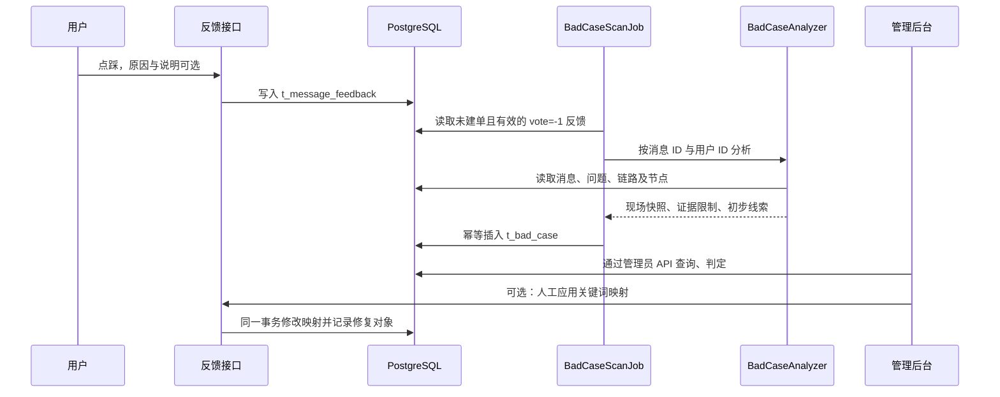

# 点踩离线分析链路：实现与使用

原始需求保存在 [offline-bad-case-plan.md](offline-bad-case-plan.md)。本实现覆盖阶段一至五，并提供阶段六的人工应用关键词映射。

## 当前项目适配

星序默认使用 AgentScope Agent。Agent 消息属于 t_agent_message，RAG 消息属于 t_message；两者共用 t_message_feedback。BadCaseMessageProvider 负责按消息类型和用户读取现场，BadCaseAnalyzer 统一生成报告。

当前 Bad case 可直接从消息 blocks 构造用户可见事件树；若存在自建运行审计，则通过 assistant_message_id → run_id 精确关联完整模型/工具节点。旧 OTel trace ID 仅作为历史数据保留，不再由 Agent 写入或读取。

RAG 通过 JdbcConversationMemoryStore.append 将当前 trace ID 传入消息 BO；ConversationMessageServiceImpl.addMessage 保存后，反向绑定 t_rag_trace_run.message_id。用户消息不写入 trace ID。Trace 反向关联失败只记录日志，不让已保存消息失败。

## 执行链路



## 如何查看

管理员登录后，从侧栏进入“Bad case 分析”，路径 /admin/bad-cases。默认显示待判定记录，可按状态、根因筛选。详情提供用户问题、回答、reasoning、来源、grounding、节点与错误信息，文档来源可通过已有预览页面打开。

每 5 分钟扫描最近 60 分钟的未建单反馈；启动 90 秒后和每小时还会补扫历史未建单记录，每批最多 50 条。页面“补扫历史反馈”可立即处理一批，返回新增、失败与扫描数量。单条失败不影响同批其他记录，下次可重试。

保存人工判定时使用 revision 乐观锁；他人已更新会拒绝覆盖，刷新后再操作。REVIEWED 与 FIXED 必须选根因。修改关键词映射需管理员手动填写原始词和目标词并点击应用；修复对象 ID 为空时新建精确映射，有 ID 时更新该规则词项并启用。配置变更与台账更新在同一事务中，提交后再次清理映射缓存。应用后保留 REVIEWED，完成回归后人工标记 FIXED。

其他动作提供现有配置页入口及 fix_ref/fix_note 记录，按对应配置流程修改。没有把人工判定或点踩自动写入 Agent 长期记忆，也没有调用 LLM 自动判定。

## API

所有以下接口要求 admin 角色：

| 方法 | 路径 | 用途 |
| --- | --- | --- |
| GET | /rag/bad-cases?page=1&size=10&reviewStatus=PENDING&rootCause= | 分页列表，列表不加载大段现场 |
| GET | /rag/bad-cases/{id} | 完整快照和人工判定 |
| PUT | /rag/bad-cases/{id}/review | 保存根因、动作、对象、备注、状态与 revision |
| GET | /rag/bad-cases/stats | 全量状态及人工根因分布 |
| POST | /rag/bad-cases/scan?includeOlder=true | 补扫一批历史反馈 |
| POST | /rag/bad-cases/{id}/apply-mapping | 人工创建/更新关键词映射并记录台账 |

## 初步线索的证据边界

R1、R2、R9 是 Agent 与 RAG 共用的通用状态线索。RAG 保留 R3–R8、R10：R4 仅在已记录检索节点时提示消息侧证据为空，不能直接等同于真实召回为空；R5、R7、R10 使用词面重合启发式，只输出“疑似/需核查”，不能判定语义或幻觉；R6 比较近 7 天 RETRIEVE 成功节点的耗时 P95，无样本时使用配置阈值；R8 提示有来源时的拒答措辞。

Agent 使用 t_agent_run 与 t_agent_run_node 中的真实字段执行 A1–A8：A1 是默认关闭且误报较高的“未调用工具却给出具体回答”线索；A2 检查 search_knowledge 失败；A3 检查问题与工具结果的词面重合（默认下限 15%）；A4 检查回答与工具结果的词面重合（默认下限 25%，回答文本为分母）；A5 检查检索工具耗时（默认 3000 ms）；A6 检查工具入参 query 与用户问题是否漂移（需要完整采集的 inputPayload）；A7 检查模型轮次（默认超过 6）及同名工具重复调用（默认超过 3 次）；A8 检查检索成功但结果为空或包含未找到提示。

A3、A4、A6 仅是词面启发式，不代表语义相关性或幻觉结论，必须由人工核对。A6 在运行审计未完整采集或缺少工具入参时不执行，并在 evidenceNotes 说明。规则仅在 bad case 分析时运行，默认配置继续关闭 A1。

sources 与 retrieved_chunks 是消息侧展示/追问证据，不等同于真实 prompt。现有 REWRITE 节点没有正文时不执行语义漂移规则，并在 evidence_notes 标明缺失；现有 RETRIEVE 不含真实结果时不会伪造。用户问题优先使用 reply_to_message_id，否则按同一用户/会话的前一条用户消息推定，并记录限制。

历史 RAG 消息未保存 trace ID 时，只在同一用户、同一会话和前后五分钟内寻找候选：唯一候选标记 TIME_CANDIDATE 和 traceMatchedByFallback=true；多个候选标记 AMBIGUOUS，不自动选取。候选不会自动回写消息。正式新消息使用精确关联。

## 数据库及历史关联

- 新库：resources/database/schema_pg.sql；服务器发布副本在 resources/docker/server/releases/starline-20261022/schema_pg.sql。
- 已有库：resources/database/migrations/20261024_bad_case.sql，事务内增量、可重复执行。
- 历史候选只读检查：20261024_bad_case_trace_backfill_preview.sql。
- 人工核对后按 message_id/user_id/trace_id 单条回填：20261024_bad_case_trace_backfill.sql；需显式传入三个 psql 变量。不会批量猜测旧链路。
- 部署校验：20261024_bad_case_verify.sql；用事务内合成记录验证唯一约束并 ROLLBACK，只输出结构与计数。

t_bad_case 的 message_id + user_id 唯一约束保证多实例幂等。台账保存建单时的现场；后续反馈编辑不会覆盖已有人工作业的快照。90 天以前的 FIXED/IGNORED 快照会归档并清理大段文本/节点，保留唯一键墓碑避免重建；待处理记录不自动删除。原反馈和消息保留策略沿用原项目。

## 配置

bootstrap/src/main/resources/application.yaml：

```yaml
rag:
  feedback:
    bad-case:
      enabled: true
      scan-delay-ms: 300000
      lookback-minutes: 60
      batch-size: 50
      retention-days: 90
      retrieve-slow-threshold-ms: 3000
      retrieve-overlap-min: 0.15
      answer-overlap-min: 0.25
      tool-slow-threshold-ms: 3000
      max-rounds: 6
      max-same-tool-calls: 3
      enable-no-tool-call-rule: false
```

enabled 控制后台扫描及归档；管理员仍可显式补扫。运行环境可使用同名 Spring 配置环境变量覆盖。默认配置不需要新增外部中间件。


## 本次验证记录

2026-10-24：前端 build 与 tsc 通过；后端 8 模块打包通过；选定测试 94 项中 90 项通过、4 项已有 Live 测试跳过，无失败/错误。数据库迁移已提交，唯一约束事务校验通过并回滚合成数据。部署后首轮后台扫描将现有 1 条 Agent 点踩生成为 1 条 PENDING 台账，问题/回答存在、节点数 3，未登录管理接口访问被拒绝。

生产环境没有代管理员实际应用关键词映射；修复入口需要人工填写并点击，保存后请按业务问题回归验证。详细操作记录见 ../server-operations.md。
