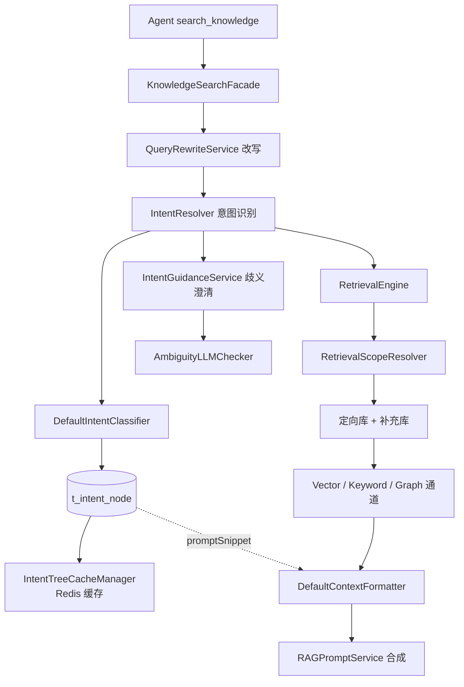

# 意图树全量移除方案

## 结论

技术上可以移除，但**不建议一次删完**。建议分两段：先做数据层灰度验证收益，确认值得后再做代码层删除。

原始理由：意图树现在只剩「知识路由」一个职责（MCP / SYSTEM 类型已在 `IntentTreeServiceImpl` 中显式拒绝），而它唯一不可替代的产物是三条 `promptSnippet` 答题纪律。这三点没找好去处之前，删代码会静默降级答案质量。

移除的真实收益是**每次检索少一轮 LLM 调用**（改写 → 意图 → 合成，意图占 1/3 往返；多子问题并行故不叠加但至少一次），代价是检索永远走全局、歧义澄清能力消失、评测维度丢失。

## 当前架构

关键事实：

- `DefaultIntentClassifier.classifyTargets()` 只把 `isKB()` 的叶子送 LLM，第 148 行注释明确「系统应答与 MCP 工具均由 Agent 主流程处理」。
- `IntentTreeServiceImpl` 第 132、200 行对 MCP 类型直接抛 `ClientException`，`mcp_tool_id` / `require_confirm` 已是死字段。
- `t_intent_node` 是孤岛表，全库 schema 无任何其它表引用它（仅自身 `intent_code` 字段）。
- `promptTemplate` 在 8 个初始化节点中一个都没配，`RAGPromptService.configuredTemplate()` 永远返回 null，走 `AgentPromptResolver` 兜底 —— 同样是死路径。
- `classifyTargets()` 在意图树无 KB 叶子时直接返回 `List.of()`，**不发 LLM 调用**。这是零改动的灰度开关。

## 三个阻塞项

### 1. promptSnippet 必须重新安家（硬阻塞）

`DefaultContextFormatter` 第 89 行与第 102 行从 `NodeScore → IntentNode.getPromptSnippet()` 取规则。意图识别关掉后 `kbIntents` 为空，第 65-67 行走 `formatChunksWithoutIntent`，`renderKbSection("", docBlocks)` 导致 `<rules>` 段整块消失。不抛异常、HTTP 200、答案排版照旧，唯一痕迹是第 62 行一条 info 日志。

现有三条（`resources/initializer/starline-events/prompts/intent-snippets/`）：

| 片段 | 内容要点 |
| --- | --- |
| reminder-rules.txt（142 字） | 只依据正式规则、不从常识推断；iCal 渠道、已核验时间固定提前 10 分钟；未核验不得声称提醒已创建 |
| source-check.txt（116 字） | 区分官方白名单与未核实线索；字段冲突不替用户下结论；过期说明最近核验时间 |
| platform-capability.txt（88 字） | 只讲公开字段与接入边界，不承诺固定 API；具体事实走实时查询 |

注意 `reminder-rules` 与 `source-check` 的 `knowledge-base-ref` **都是 `policy`**。规则粒度比知识库细，这是它必须挂在节点而非库上的原因。若把规则下移到库维度，一个库只能有一套规则，两个主题会串味。

三个可选去处，按推荐排序：

- **A（推荐，成本最低）**：追加到 `AgentPromptSlot.KB_ANSWER` 系统提示词。三条都是「别瞎承诺」型边界纪律，星序业务内互不冲突，可合并成一段通用约束。代价是丢失按主题差异化，但当前 2 库 6 文档规模下主题区分度本就有限。
- **B（推荐程度次之）**：新建 `t_kb_answer_rule` 表，字段 `collection_name` + `keywords` + `rule_text`，检索后按命中块的 collection 与问题关键词匹配注入。保住差异化，但要新增一套匹配逻辑与后台管理页。
- **C（不推荐）**：把规则写进知识库文档正文。会被检索出来，但模型是否遵守完全靠运气，且污染证据文本。

### 2. 歧义澄清能力整体消失

`IntentGuidanceService` 依赖 `subIntents` 的路径重名比较，没有意图树就没有路径概念，整条能力无法平移。

当前影响为零：8 个节点里没有同名路径，该链路从未被真实触发。但这是**能力删除而非损失为零** —— 将来出现「数据安全」在多个业务下同名的场景，用户不会再被追问。

接受的写法：删除时在变更记录里明确写「歧义澄清能力下线」，不要写成「无影响」。

### 3. 评测维度丢失

`EvalController` 第 67 行调 `intentResolver.resolve()`，第 94-95 行输出 `intents` 与 `intentLeafIds`。移除后这两个字段为空。

影响：历史评测报告与新报告不可比，命中率无法再按意图归因。若还在用 `resources/regression/` 下的评测集做回归，需要先决定字段是删除还是置空。

## 执行顺序

### 阶段 0 · 灰度验证（零代码改动，先做这个）

目的：在真实流量下量出「移除意图识别」的收益与损失，避免大规模重构后发现不值得。

1. `UPDATE t_intent_node SET enabled = 0;`（8 个节点，软关闭，可秒回滚）
2. `classifyTargets()` 因无 KB 叶子直接返回空 → 不发 LLM、不注入 snippet、不起歧义澄清、检索走全局
3. 观察 3 天：检索 P95 延迟变化、点踩率变化、`检索归因 - 提示词分支` 日志是否稳定落在「无可用意图」
4. 同步验证补充路兜底效果：`补充范围 N 个库` 日志应始终为全局

如果这一步就发现答案质量明显下滑（大概率来自 snippet 缺失），先做阻塞项 1 的迁移，再重跑。

**风险**：此阶段 `promptSnippet` 已失效。要么接受 3 天降级，要么先完成 snippet 迁移再灰度。

### 阶段 1 · 前端下线（低风险，可独立发布）

先行移除管理入口，避免用户继续在后台配置将被删除的数据。

| 文件 | 动作 |
| --- | --- |
| `frontend/src/router.tsx` | 删第 16-18 行 import；删 `intent-tree`、`intent-list`、`intent-list/:id/edit` 三条路由（约第 166-176 行） |
| `frontend/src/pages/admin/AdminLayout.tsx` | 删 `id: "intent"` 菜单组（约 115-130 行）；删第 208-209 行标题映射；第 234 行 `openGroups` 去掉 `intent`；删第 312-320、375、381 行 intent 相关判定 |
| `frontend/src/pages/admin/intent-tree/IntentTreePage.tsx` | 删除 |
| `frontend/src/pages/admin/intent-tree/IntentListPage.tsx` | 删除 |
| `frontend/src/pages/admin/intent-tree/IntentEditPage.tsx` | 删除 |
| `frontend/src/services/intentTreeService.ts` | 删除 |
| `frontend/src/pages/admin/agent-skills/AgentSkillEditPage.tsx` | 第 272、277 行文案「列表来自意图树」「意图树里还没有 MCP 节点」已过期，MCP 节点早已不能建，改为指向 MCP 工具管理 |
| `frontend/src/pages/admin/change-logs/BizChangeLogPage.tsx` | 确认 `INTENT_TREE` 类型映射；后端常量删除后需同步 |
| `frontend/src/pages/admin/agents/AgentProfilePage.tsx` | grep 命中，逐个确认是否真依赖 |

### 阶段 2 · 后端删除（主体工作量）

先删叶子，再改主干，最后清签名。每步保证能编译。

**2.1 纯删除（无内部依赖）**

核心包 8 个：

- `rag/core/intent/DefaultIntentClassifier.java`
- `rag/core/intent/IntentClassifier.java`
- `rag/core/intent/IntentNode.java`
- `rag/core/intent/IntentNodeRegistry.java`
- `rag/core/intent/IntentResolver.java`
- `rag/core/intent/IntentTreeCacheManager.java`
- `rag/core/intent/NodeScore.java`
- `rag/core/intent/NodeScoreFilters.java`

引导包 3 个：

- `rag/core/guidance/IntentGuidanceService.java`
- `rag/core/guidance/AmbiguityLLMChecker.java`
- `rag/core/guidance/GuidanceDecision.java`

DTO 2 个：

- `rag/dto/SubQuestionIntent.java`
- `rag/dto/IntentCandidate.java`

管理后台一整条：

- `rag/controller/IntentTreeController.java`
- `rag/controller/vo/IntentNodeTreeVO.java`
- `rag/controller/request/IntentNodeCreateRequest.java`
- `rag/controller/request/IntentNodeUpdateRequest.java`
- `rag/controller/request/IntentNodeBatchRequest.java`
- `rag/ingestion/service/IntentTreeService.java`
- `rag/ingestion/service/impl/IntentTreeServiceImpl.java`
- `rag/dao/entity/IntentNodeDO.java`
- `rag/dao/mapper/IntentNodeMapper.java`
- `rag/enums/IntentKind.java`、`rag/enums/IntentLevel.java`（确认无其它引用后删）

配置与常量：

- `rag/config/GuidanceProperties.java`
- `RAGConstant` 第 47、53、68、74、80 行共 5 个常量
- `SearchChannelProperties.Scope` 内 `minIntentScore`（152 行）、`confidenceThreshold`（158 行）、`supplementRatio`（167 行）全部失效，`ScopeQuota.split()` 的补充路逻辑需一并简化

提示词模板：

- `rag/src/main/resources/prompt/intent-classifier.st`
- `rag/src/main/resources/prompt/guidance-prompt.st`
- `rag/src/main/resources/prompt/guidance-ambiguity-check.st`

**2.2 主干改造（按依赖倒序）**

| 文件 | 改造要点 |
| --- | --- |
| `rag/service/KnowledgeSearchFacade.java` | 删 `intentResolver`、`guidanceService` 注入；第 66-75 行的 intent resolve 与歧义判定整段删除；第 87 行 `mergeKbIntents` 删除；`PromptContext` 不再设 `kbIntents` / `eligibleIntentIds` |
| `rag/core/prompt/PromptContext.java` | 删 `kbIntents`（43 行）、`eligibleIntentIds`（49 行） |
| `rag/core/prompt/ContextFormatter.java` | `formatKbContext` 去掉 `List<NodeScore>`、`Set<String>` 两个参数 |
| `rag/core/prompt/DefaultContextFormatter.java` | 删 `formatSingleIntentContext`、`formatMultiIntentContext`、`eligibleIntents`、`renderSnippetRules`；`formatKbContext` 直接调 `formatChunksWithoutIntent` |
| `rag/core/prompt/RAGPromptService.java` | 删 `configuredTemplate()`（129-147 行，本就是死路径）；`buildSystemPrompt` 直接走 `agentPromptResolver.resolve(KB_ANSWER)` |
| `rag/dto/RetrievalContext.java` | 删 `intentChunks`（44 行）、`eligibleIntentIds`（50 行）；调用方 `EvalController` 同步 |
| `rag/core/retrieval/RetrievalEngine.java` | `retrieve(List<SubQuestionIntent>)` → `retrieve(String question)`；`retrieveAndRerank` 去掉 `List<NodeScore>` 参数；第 99-130 行 eligible 汇总删除 |
| `rag/core/retrieval/MultiChannelRetrievalEngine.java` | `retrieveKnowledgeChannels(SubQuestionIntent, ...)` → `(String question, ...)`；第 274 行 `buildSearchContext` 去掉 intents |
| `rag/core/retrieval/KnowledgeRetrievalResult.java` | 删 `intentIdsByChunkKey`、`directedIntentIds`、`retrievedIntentIds()`、`eligibleIntentIds()`、`groupByIntent()` |
| `rag/core/retrieval/channel/RetrievalScopeResolver.java` | 退化为直接返回 `RetrievalScope.global(...)`，或整体删除并让通道读全局库列表 |
| `rag/core/retrieval/channel/RetrievalScope.java` | 删 `directed`、`kbIntents`、`supplementCollections` 语义，只留 `targetCollections` |
| `rag/core/retrieval/channel/SearchContext.java` | 删 `intents` 字段（56 行） |
| `rag/core/retrieval/channel/VectorSearchChannel.java`、`KeywordSearchChannel.java`、`GraphSearchChannel.java` | 删 `ScopeQuota.split` 双路逻辑与 `supplementRatio`，改为单路全局检索 |
| `rag/core/retrieval/channel/ScopeQuota.java` | 可直接删除 |
| `rag/eval/EvalController.java` | 删 `intentResolver` 注入与第 67 行；`buildResponse` 去掉对应字段；第 190-206 行 `extractSubIntents` / `extractTopLeafIds` 删除 |

**2.3 初始化器**

| 文件 | 动作 |
| --- | --- |
| `resources/initializer/starline-events/IntentTreeInitMain.java` | 删除 |
| `resources/initializer/starline-events/InitializeMain.java` | 第 21 行去掉 `initializeIntentTree` 调用 |
| `resources/initializer/common/InitializationActions.java` | 删 `initializeIntentTree`（281 行起）；第 46、54、80-81 行去掉 `intent-count` 预检与统计 |
| `resources/initializer/starline-events/intents/*.properties` | 8 个文件删除（000/100/200/210/300/400/410/500） |
| `resources/initializer/starline-events/prompts/intent-snippets/*.txt` | 3 个文件按阻塞项 1 的方案迁移后删除 |
| `resources/initializer/starline-events/checksums.sha256` | 重算 |
| `initializer.properties` | 去掉 `verification.intent-count` |

**2.4 测试（16 个，grep 命中）**

需逐个判定是删除还是改造：

- 直接删：`SimpleIntentClassifierTests`、`IntentNodeJsonTest`、`DefaultIntentClassifierTest`、`AmbiguityLLMCheckerTest`、`IntentGuidanceServiceTest`、`RetrievalScopeResolverTest`
- 改造：`DefaultContextFormatterTest`、`RAGPromptServiceTest`、`RetrievalEngineTest`、`MultiChannelRetrievalEngineTest`、`VectorSearchChannelTest`、`KeywordSearchChannelTest`、`GraphSearchChannelTest`、`KnowledgeSearchFacadeTest`、`AgentToolCatalogTest`、`ReActAgentProviderTest`

### 阶段 3 · 数据与审计

1. 备份 `t_intent_node` 全表数据
2. `DROP TABLE t_intent_node;`（无外键依赖，可直接删）
3. 迁移脚本放 `resources/database/upgrades/v2.x.x/`，同步 `schema_pg.sql` 第 244-270 行删除建表与唯一索引
4. `BizChangeBizType.INTENT_TREE`（第 31 行）删除，同步前端映射
5. 历史变更日志里的 `INTENT_TREE` 记录保留，不追溯清理

## 回滚

| 阶段 | 回滚方式 |
| --- | --- |
| 阶段 0 | `UPDATE t_intent_node SET enabled = 1;`，秒级 |
| 阶段 1 | 前端回滚旧 bundle |
| 阶段 2 | 回滚旧 JAR（表还在，代码回滚即可完整恢复） |
| 阶段 3 | 从 `t_intent_node` 专用备份恢复 + 回滚 JAR |

关键纪律：**阶段 3 必须严格晚于阶段 2 验证通过**。表在、代码回滚 = 完整恢复；表删了就只能靠备份。

## 验收

- `mvn -pl bootstrap -am -Dmaven.test.skip=true package` 通过；`npm run build` 通过；`tsc -p tsconfig.app.json` 无错
- 静态核验：发布包不含 `IntentNode` / `NodeScore` / `IntentResolver` 等类；全量 schema 无 `t_intent_node`
- 真实检索回归：至少覆盖提醒规则、来源核验、平台能力三类问题，确认三条答题纪律**在新载体上仍然生效**（这是最容易漏的一项）
- 评测接口返回结构确认：`intents` / `intentLeafIds` 字段的去留已对齐
- 变更记录明确写明「歧义澄清能力下线」，不写「无影响」

## 工作量与建议

| 项 | 规模 |
| --- | --- |
| 主代码删除 | 11 个核心类 + 2 DTO + 9 管理后台类 + 2 配置 + 3 模板 |
| 主代码改造 | 18 个文件（含 3 个检索通道签名） |
| 前端 | 5 删 3 改 |
| 初始化器 | 3 改 + 8 删 |
| 测试 | 16 个 |
| 数据库 | 1 张表 |

判断：**当前 2 个知识库、6 篇文档的规模下，移除的收益（省一轮 LLM 调用）真实但有限，成本（18 个文件签名改造 + 三条纪律迁移 + 评测维度丢失）不小。**

建议先跑阶段 0 三天。如果延迟收益在 P95 上看不出来，就停在那里 —— 数据层关闭已经拿到了全部运行时收益，代码层删除只买到可维护性，而可维护性可以等知识库数量涨起来、真需要重构检索作用域时再一起做。
