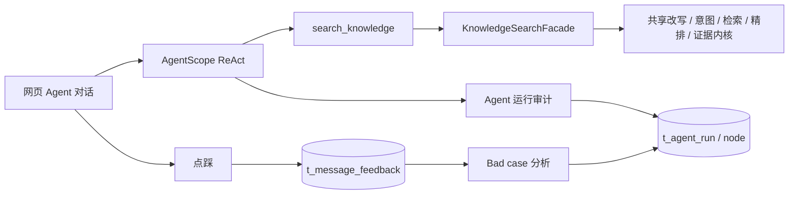

# workflow 入口下线实施记录

## 当前架构

Agent 是唯一对话入口。starlineagent.engine.type 默认且仅接受 agent；错误配置旧引擎会明确报错。

## 已移除

- workflow 独立聊天、停止、会话、反馈、推荐问题和 RAG Trace API。
- 独立会话/摘要/消息、流式编排、旧记忆、聊天限流、反馈 MQ 消费者、Trace AOP/存储、workflow 看板实现。
- 旧前端聊天页/store/service、旧 Trace 页面/路由/导航、双引擎看板和设置。
- 旧全量 schema 中的五表、索引和列注释，以及对旧表的后续增量语句。
- workflow 专有测试随实现一并删除；共享 Bad case 与 Agent 看板测试适配新结构。

## 保留与方案调整

- 共享 KnowledgeSearchFacade 及检索内核保持原字节；意图、Prompt、Skills、知识库入库、Agent 记忆/确认/审计保留。
- DocumentSourceRequest 被 IngestionTaskCreateRequest 和 IngestionTaskServiceImpl 使用，因此保留。
- 点踩原因弹窗、文档 Markdown 渲染器被 Agent/文档预览复用，迁移到 frontend/src/components/common。
- 文档渲染器按需加载；高亮只注册 bash/json/java/python/sql/javascript/typescript，其他语言保留可读代码文本。这样降低构建内存，避免全量高亮模块进入主包。
- BadCaseAnalyzer、BadCaseRepository 实际仍引用旧 Trace DAO/表，原方案删除清单未完全覆盖。保留 Bad case 体系，同时删除旧 Trace 关联逻辑；仅通过 Agent provider 精确关联新审计；无可访问消息时标记 UNKNOWN/MISSING。
- 旧检索 P95 表下线后使用配置兜底阈值，未把包含模型生成时间的 search_knowledge 工具耗时当成检索 P95。
- 共享模型客户端必须注入 RagStreamTraceSupport。bootstrap 新增 ModelStreamTraceConfiguration 返回 NOOP 回调，避免修改共享客户端/检索内核；不写数据库，不恢复旧 Trace 功能。
- OrchestrationMode.WORKFLOW 及 Prompt/意图内核中的兼容分支按方案保留，配置入口已限制为 agent。共享 Trace 注解/回调接口暂留为兼容契约，无旧存储实现。
- 入库 Pipeline、RocketMQ 事务消息、业务变更审计属于共享功能，不随旧聊天入口下线。
- 旧发布记录、数据库 upgrades/backups 保留版本历史；新库只使用最新 schema + init_data，不重放旧升级脚本。
- 不自动删除历史孤儿反馈或真实 Bad case。

## 数据与发布顺序

1. 本地按将修改的文件保存源码快照和清单：.local-backups/workflow-retire-20261024/。此目录被 Git 忽略；没有把用户此前所有未提交文件自动提交成基线。
2. 服务器备份五张旧表并检查可读取；备份权限600。
3. 备份现有 JAR/前端/schema/外置配置/Compose。
4. 原子替换发布文件、重建 API/Web，先确认 Agent 工具、审计、设置、看板、反馈和 Bad case。
5. 精确 DROP 五表，使用 RESTRICT，遇到未知依赖则事务失败，不扩大删除。
6. 删表后复用真实运行验证审计、看板和 Bad case 扫描，核对五表不存在。
7. 任一步失败：恢复旧应用；如已删表，从五表专用备份恢复，不覆盖 Agent 业务库其他表。

五表：t_conversation、t_message、t_conversation_summary、t_rag_trace_run、t_rag_trace_node。
保留：t_message_feedback、全部 t_agent_*、知识库、入库、Prompt/Skills、用户和星序业务表。

## 验证与记录

- 82项关键回归通过；最后补删无使用方的两个旧类型后重新打包通过。
- 实际 src TypeScript 检查、Vite 生产构建通过。首次根项目引用检查不覆盖 src，后续已改为显式 -p tsconfig.app.json。
- 静态核验：发布包无已删除旧类、共享检索内核哈希不变、全量 schema 无旧表引用。
- 服务器真实验证脚本：scripts/verify-workflow-retirement.py。只对明确标记的新测试回答点踩，验证落表和 Bad case 精确关联后，将该测试反馈与台账软删除；不清理真实反馈。
- 所有服务器命令和最终执行结果：docs/server-operations.md。
- 逐文件变更：docs/change-log/2026-10-24.md。
